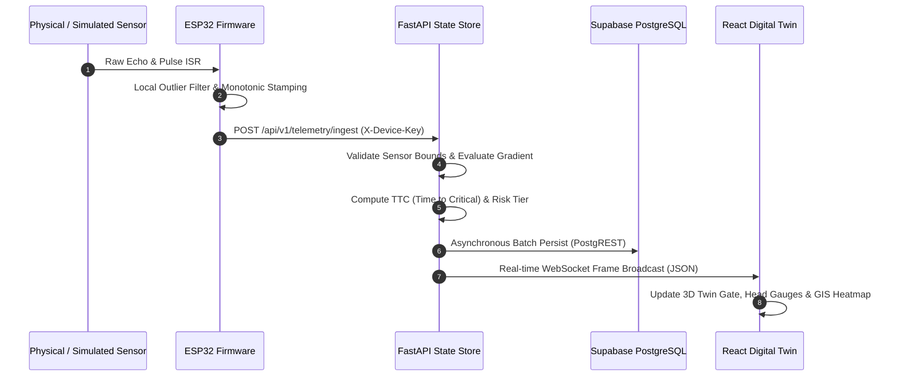

# DRAIN-X
### Observe to Resolve — Predictive Urban Drainage Intelligence System

[]()
[](https://fastapi.tiangolo.com)
[](https://react.dev)
[](https://www.typescriptlang.org)
[](https://supabase.com)
[](https://platformio.org)
[](https://flutter.dev)
[](LICENSE)

DRAIN-X is an enterprise-grade, end-to-end **predictive urban drainage intelligence and active flood mitigation platform**. It unifies physical IoT edge sensing, high-throughput sensory telemetry processing, real-time hydraulic state modeling, automated fail-safe diversion actuation, digital twin geospatial monitoring, and multi-stakeholder civic incident workflows.

Developed by **Team NIRAKSHAN** as an IoT and municipal intelligence prototype for the *IDEAS 5.0 — Idea to Impact* innovation initiative.

---

## Table of Contents
1. [Overview](#-overview)
2. [Problem Statement](#-problem-statement)
3. [The DRAIN-X Closed-Loop Workflow](#-the-drain-x-closed-loop-workflow)
4. [System Architecture](#-system-architecture)
5. [Architecture & Ecosystem Diagrams](#-architecture--ecosystem-diagrams)
6. [Implemented Capabilities](#-implemented-capabilities)
7. [Physical Prototype & Hardware Model](#-physical-prototype--hardware-model)
8. [Application Ecosystem](#-application-ecosystem)
9. [Digital Twin & GIS Dashboard](#-digital-twin--gis-dashboard)
10. [Development Roadmap](#-development-roadmap)
11. [Technology Stack](#-technology-stack)
12. [Repository Structure](#-repository-structure)
13. [Installation & Local Setup](#-installation--local-setup)
14. [Environment Configuration](#-environment-configuration)
15. [Automated Testing & Quality Verification](#-automated-testing--quality-verification)
16. [Deployment Architecture & Staging](#-deployment-architecture--staging)
17. [Current Project Status](#-current-project-status)
18. [Future Vision](#-future-vision)
19. [Team & License](#-team--license)

---

## 📌 Overview

During intense precipitation, stormwater drainage networks in modern cities frequently choke due to accumulated debris, plastics, construction silt, and illegal dumping. Conventional stormwater management is almost entirely **reactive**: municipal authorities dispatch maintenance personnel only after surface roads are inundated, traffic grids stall, or citizen grievances flood social media.

DRAIN-X transforms urban drainage into a proactive, intelligent, closed-loop cyber-physical system:
- **Continuous Sub-surface Sensing:** Measures hydraulic head, volumetric discharge, and velocity differentials across interconnected drainage sections.
- **Physics-Informed Anomaly Detection:** Detects sub-surface hydraulic choke points and localizes developing obstructions before water overflows street-level grates.
- **Dynamic Time-to-Critical (TTC) Prediction:** Forecasts flood risk levels and water-level rise rates to give emergency teams actionable advance warning.
- **Autonomous & Fail-Safe Interventions:** Activates physical diversion gates to relieve hydrostatic head while maintaining strict fail-safe baseline postures.
- **Multi-Stakeholder Collaboration:** Coordinates municipal administrators, field maintenance crews, and citizens through synchronized dashboards and mobile applications.

---

## 🚨 Problem Statement

Every monsoon, urban agglomerations suffer catastrophic waterlogging, economic damage, and loss of life due to clogged stormwater infrastructure.

### Critical Challenges in Urban Stormwater Management:
1. **Blind Sub-Surface Conditions:** Drainage channels are subterranean; blockages develop invisibly until water backs up onto roadways.
2. **Delayed Single-Threshold Sensing:** Traditional flood sensors only alarm when water levels cross an arbitrary emergency limit at a single point, offering zero diagnostic lead time.
3. **No Spatial Localization:** A lone water-level gauge cannot identify *where* a blockage has occurred along a multi-kilometer conduit.
4. **Manual & Uncoordinated Dispatch:** Maintenance crews are dispatched without exact location coordinates, verified severity levels, or on-site photographic evidence.
5. **No Active Hydraulic Relief:** Passive drainage infrastructure cannot reroute excess water away from high-density intersections during localized choke points.

---

## 💡 The DRAIN-X Closed-Loop Workflow

DRAIN-X operates on an authoritative seven-stage operational loop:

```text
  [ 1. SENSE ] ----> [ 2. DETECT ] ----> [ 3. LOCALIZE ] ----> [ 4. PREDICT ]
       ^                                                              |
       |                                                              v
  [ 7. VERIFY ] <--- [ 6. INTERVENE ] <---------------------- [ 5. ALERT ]
```

1. **Sense:** ESP32 edge microcontroller reads ultrasonic water depths and Hall-effect flow pulses at upstream and downstream nodes.
2. **Detect:** Backend ingestion pipeline validates monotonic timestamps, sensor bounds, and flow continuity to flag anomalies.
3. **Localize:** Sectional gradient comparison evaluates hydraulic head loss and discharge delta ($Q_{in} - Q_{out}$) to isolate the obstructed conduit.
4. **Predict:** Physics-based heuristic engine computes rate of water rise ($cm/min$), Time-to-Critical ($TTC$), and four-tier risk classifications (`NORMAL`, `WATCH`, `WARNING`, `CRITICAL`).
5. **Alert:** High-priority alerts propagate via WebSockets to municipal SCADA monitors and trigger citizen notification pipelines.
6. **Intervene:** The automated or operator-commanded diversion mechanism actuates servo gates to relieve downstream surcharge.
7. **Verify:** Post-actuation telemetry confirms drop in hydraulic head and stabilization of channel flow, closing the remediation loop.

---

## 🏗 System Architecture

DRAIN-X is engineered as a modular monolith optimized for high reliability, clear role boundaries, and graceful degradation:

- **IoT Edge & Microcontroller Tier:** ESP32 DevKit V1 written in C++ (PlatformIO) featuring dual-core FreeRTOS scheduling, hardware interrupt pulse counting for flow meters, non-blocking ultrasonic echo timing, local moving-average sensor filtering, and autonomous loss-of-signal fail-safe hold.
- **Backend Application Core:** Python 3.12 / FastAPI asynchronous service handling device-authenticated REST ingestion, internal in-memory state caching, physics simulation benchmarks, operational mode state machines (`SIMULATION`, `PHYSICAL`, `SAFE_HOLD`), and real-time WebSocket broadcasting (`/api/v1/telemetry/stream`).
- **Cloud Persistence & Security Tier:** Supabase PostgreSQL 15 with PostgREST endpoints, Row Level Security (RLS) policies, and modern cryptographic JWT verification supporting both asymmetric ECDSA P-256 (`ES256`) via trusted JWKS and symmetric HMAC (`HS256`).
- **Web Command & Digital Twin Dashboard:** React 18 + TypeScript + Vite SPA incorporating interactive Leaflet GIS network mapping, procedural 3D CSS digital twin diversion gate visualization, live Recharts streaming graphs, historical telemetry scrubbing playback, and incident management dispatch.
- **Mobile Cross-Platform Application:** Flutter application architecture providing role-based user experiences for Citizens, Municipal Supervisors, and Field Workers with structured incident reporting and lifecycle transition tracking.

---

## 📊 Architecture & Ecosystem Diagrams

### 1. End-to-End System Architecture

```mermaid
flowchart TD
    subgraph EdgeHardware["IoT Edge Tier (Physical Flume / Model)"]
        ESP32["ESP32 DevKit V1 (FreeRTOS)"]
        US_Sensors["Ultrasonic Sensors (JSN-SR04T / HC-SR04)"]
        Flow_Sensors["Hall-Effect Flow Sensors (YFS201)"]
        Servo_Gate["Servo Diversion Gate (SG90 / MG996R)"]
        US_Sensors -->|Echo Pulse| ESP32
        Flow_Sensors -->|Interrupt ISR| ESP32
        ESP32 -->|PWM Actuation| Servo_Gate
    end

    subgraph BackendCore["FastAPI Backend Core (Python 3.12)"]
        Ingest["Telemetry Ingest Endpoint (/api/v1/telemetry/ingest)"]
        StateStore["Authoritative In-Memory State Store"]
        Analytics["Hydraulic Modeling & Risk / TTC Prediction"]
        SimRunner["Scenario Benchmark Runner (Simulated Physics)"]
        StreamHub["Live WebSocket Broadcast Hub (/stream)"]
        Security["JWT & Device Key Cryptographic Validator"]

        Ingest --> Security
        Security --> StateStore
        StateStore --> Analytics
        SimRunner -.->|Synthetic Telemetry| StateStore
        StateStore --> StreamHub
    end

    subgraph CloudPersistence["Cloud Persistence & Security (Supabase)"]
        PostgREST["PostgREST API v1"]
        PgTables[("PostgreSQL 15 Tables: sensor_readings, alerts, incidents, devices")]
        RLS["Row Level Security Policies (citizen, municipality, worker)"]
        AuthService["GoTrue Auth Service (ES256 JWKS)"]

        PostgREST --> PgTables
        PgTables --- RLS
    end

    subgraph PresentationTier["Presentation & Mobile Ecosystem"]
        ReactDashboard["React 18 + Vite Municipal Dashboard (GIS + 3D Twin)"]
        FlutterApp["Unified Flutter Mobile App (Citizen / Worker / Muni)"]
    end

    ESP32 -->|HTTPS Post + X-Device-Key| Ingest
    BackendCore -->|Service Role PostgREST / Async Pool| PostgREST
    Security -->|Fetch Trusted JWKS / Key Verification| AuthService
    StreamHub -->|WebSocket (WSS)| ReactDashboard
    BackendCore -->|REST API v1| ReactDashboard
    BackendCore -->|REST API v1| FlutterApp
```

### 2. Information & Telemetry Data Flow



---

## ⚡ Implemented Capabilities

The following capabilities are **empirically implemented and verified** in the codebase:

### 1. Sensor Telemetry Ingestion & Invariant Validation
- **Location:** `backend/app/api/v1/telemetry.py`, `backend/app/models/contracts.py`
- Accepts high-throughput JSON telemetry payload batches.
- Strictly validates physical bounds (water depth: $0.0 - 15.0\text{ cm}$, flow rate: $0.0 - 30.0\text{ L/min}$).
- Enforces strict monotonic timestamp validation, detecting and quarantining out-of-order or duplicate packets.
- Implements device authentication via `X-Device-Key` with fail-closed production enforcement.

### 2. Hydraulic State Modeling & Blockage Localization
- **Location:** `backend/app/services/hydraulic_engine.py`, `backend/app/services/state_store.py`
- Computes hydraulic head difference ($\Delta H = H_{upstream} - H_{downstream}$) and discharge differential ($\Delta Q = Q_{upstream} - Q_{downstream}$).
- Identifies developing obstructions before full hydraulic surcharge occurs.
- Automatically calculates rate of water rise ($cm/min$) and estimates Time-to-Critical ($TTC$) until flume brim overflow.

### 3. Multi-Mode Operational State Machine
- **Location:** `backend/app/services/state_store.py`, `backend/app/api/v1/status.py`
- Enforces strict operational boundaries across three states:
  - `SIMULATION`: Advances mathematical scenarios; synthetic telemetry is clearly tagged as `DataSource.SIMULATED`.
  - `PHYSICAL`: Dedicated to live hardware ingestion; simulated scenario runner is locked out from mutating state.
  - `SAFE_HOLD`: Emergency posture freezing uncommanded actuation; holds servo gate at calibrated fail-safe angle ($0.0^\circ$).
- Maintains an auditable transition ledger recording caller identity, previous mode, target mode, and transition rationale.

### 4. Deterministic Simulation Benchmark Engine
- **Location:** `backend/app/services/scenario_benchmark.py`
- Runs 5 calibrated benchmark scenarios:
  1. `BASELINE_STEADY_FLOW`: Nominal dry/wet weather flow.
  2. `PARTIAL_BLOCKAGE_SLOW_RISE`: Progressive debris buildup at primary screening net.
  3. `CRITICAL_FLASH_SURGE`: Severe storm runoff causing rapid water level spike.
  4. `PUMP_FAILURE_DOWNSTREAM`: Backwater surcharge from secondary pumping outage.
  5. `SENSOR_FAULT_DRIFT`: Erroneous ultrasonic signal drift testing anomaly filter robustness.
- Computes standardized verification metrics: peak upstream depth, time-to-detection ($TTD$), automated mitigation latency, and maximum discharge volume.

### 5. Supabase Cloud PostgreSQL Integration & Row Level Security (RLS)
- **Location:** `backend/app/services/persistence_repository.py`, `database/migrations/`
- Full PostgREST asynchronous client adapter with soft-fail degradation (automatically buffers telemetry in-memory if cloud connectivity drops, without crashing the ASGI engine).
- Hardened multi-tenant Row Level Security policies verified across 4 distinct roles:
  - `citizen`: Public view of alerts and confirmed incidents; restricted from confidential audits and telemetry mutations.
  - `worker`: Field-level access to assigned work orders; can register edge devices and update remediation status.
  - `municipality`: Comprehensive SCADA oversight, system mode transitions, and emergency gate overrides.
  - `service_role`: Authoritative backend-only privileged key bypassing RLS for batch telemetry writes.

### 6. Cryptographic Dual-Algorithm JWT Verification
- **Location:** `backend/app/core/security.py`, `backend/tests/test_jwt_verification.py`
- Cryptographically verifies modern Supabase GoTrue Auth asymmetric tokens using ECDSA P-256 (`ES256`) against public JWKS.
- Securely derives JWKS endpoints exclusively from `settings.SUPABASE_URL` to eliminate SSRF and key-spoofing vectors.
- Retains verified HMAC-SHA256 (`HS256`) verification for offline bench tests.
- Strictly allowlists token algorithms (`ES256`, `HS256`) and rejects `none`, `RS256`, and `RS512`.
- Anti-privilege escalation engine: extracts roles strictly from `app_metadata.role`; client-supplied `user_metadata` modifications are completely ignored.

### 7. Real-Time WebSocket Telemetry Hub
- **Location:** `backend/app/services/telemetry_stream_manager.py`, `backend/app/api/v1/telemetry.py`
- High-concurrency ASGI WebSocket endpoint (`/api/v1/telemetry/stream`) broadcasting state updates at up to 10 Hz.
- Client-side topic filtering by `source` (`PHYSICAL` vs `SIMULATED`) or specific `sensor_id`.
- Automated heartbeat ping/pong frames every 30 seconds to maintain persistent connections across reverse proxies.

### 8. Interactive Digital Twin & Geospatial Dashboard
- **Location:** `frontend/src/components/`, `frontend/src/api/`
- Procedural 3D CSS visualization of the diversion gate flume reflecting physical servomotor angle in real-time.
- Interactive Leaflet GIS map with topological drain network polylines, sensor marker clustering, dynamic risk status heatmaps, and citizen incident pins.
- Historical telemetry playback scrubber allowing municipal operators to rewind, pause, step, and analyze past flood events at $1\times$, $2\times$, or $5\times$ speeds.
- Clean separation between simulated benchmarks and live hardware telemetry.

### 9. Containerization & Orchestration Readiness
- **Location:** `backend/Dockerfile`, `backend/Procfile`, `render.yaml`, `frontend/vercel.json`
- Production multi-stage Docker container (`python:3.12-slim`, non-root user `drainx`, dynamic `$PORT` binding).
- Distinct container orchestrator liveness probe (`/api/v1/health/liveness`) and Supabase persistence readiness probe (`/api/v1/health/ready`).
- Automated frontend SPA routing rewrites and security headers (`X-Frame-Options: DENY`, `X-Content-Type-Options: nosniff`).

---

## 🛠 Physical Prototype & Hardware Model

The physical counterpart of DRAIN-X is an indoor laboratory bench testbed modeling an open-channel urban drainage flume.

```
       [ Submersible Pump ]
               |
               v
     +-------------------+
     | Upstream Section  | <--- Ultrasonic Level Sensor (US_UPSTREAM_01)
     | (Inflow / Trash)  | <--- Flow Rate Sensor (PUMP_INFLOW_01)
     +---------+---------+
               |
         [ Screen / Net ]   <--- Debris / Obstruction Point
               |
     +---------+---------+
     | Diversion Section | <--- Servo Gate (SG90, 0 deg to 90 deg)
     | (Relief Bypass)   | ---> [ Bypass Flume to Storage Tank ]
     +---------+---------+
               |
     +---------+---------+
     | Downstream Outlet | <--- Ultrasonic Level Sensor (US_WEIR_02)
     | (Sharp Weir Box)  |
     +-------------------+
```

### Hardware Component Inventory:
| Component | Function / Purpose | Implementation Status |
| :--- | :--- | :---: |
| **ESP32 DevKit V1 (30-pin)** | Core microcontroller, sensor polling, local moving average filter, WiFi client. | **Firmware Complete / Simulated** |
| **JSN-SR04T / HC-SR04** | Ultrasonic level transducer measuring upstream and downstream water surface. | **Driver Implemented / Bench Tested** |
| **YFS201 Flow Sensor** | Hall-effect turbine flowmeter measuring volumetric discharge ($L/min$). | **ISR Driver Implemented** |
| **SG90 / MG996R Servo** | Actuates physical diversion relief gate based on PWM commands. | **PWM Driver Implemented** |
| **Submersible Water Pump** | Recirculates water through transparent acrylic/PVC flume channel. | **Bench Testbed Configured** |
| **Manual Gate Mechanism** | Rack-and-pinion horizontal debris removal tray. | **Physical Model Fabricated** |

> [!NOTE]
> Physical hardware firmware is authored and verified via unit tests (`firmware/test/`). Full physical field validation is scheduled for **Milestone P0.8**. All reported dashboard and cloud persistence runs are currently verified using simulated telemetry and synthetic scenario benchmarks.

---

## 📱 Application Ecosystem

DRAIN-X incorporates a unified, multi-persona cross-platform mobile application built on Flutter (`mobile/`):

```
                       +---------------------------------------+
                       |       Unified DRAIN-X Mobile App      |
                       +-------------------+-------------------+
                                           |
         +---------------------------------+---------------------------------+
         |                                 |                                 |
         v                                 v                                 v
+--------------------+            +--------------------+            +--------------------+
|  Citizen Portal    |            | Municipality Hub   |            | Field Worker Deck  |
| - Photo Incident   |            | - SCADA Overview   |            | - Assigned Tasks   |
|   Reporting        |            | - Gate Overrides   |            | - GPS Turn-by-Turn |
| - Flood Map & Risk |            | - Crew Dispatch    |            | - Voice Guidance   |
| - Multilingual UI  |            | - Mode History     |            | - Offline Status   |
+--------------------+            +--------------------+            +--------------------+
```

1. **Citizen Portal:** Enables residents to report localized drain clogging with GPS geotagging, category tagging, and camera photo capture. Displays live public flood-risk advisories.
2. **Municipality Hub:** Provides urban planners with high-level drainage asset health, remote diversion gate manual overrides, incident triage, and crew dispatch controls.
3. **Field Worker Deck:** Designed for on-ground sanitation crews with high-contrast accessibility, audio voice prompts, offline task caching, and step-by-step remediation updates (`REPORTED` $\rightarrow$ `ACKNOWLEDGED` $\rightarrow$ `DISPATCHED` $\rightarrow$ `IN_PROGRESS` $\rightarrow$ `RESOLVED`).

---

## 🌐 Digital Twin & GIS Dashboard

The municipal web application (`frontend/`) provides situational awareness for drainage command centers:

- **Procedural 3D CSS Diversion Gate:** Renders the physical flume geometry, water levels, and gate deflection without requiring heavy WebGL/Three.js runtimes.
- **Topological GIS Map (Leaflet):** Displays hydraulic conduits as color-coded lines indicating flow velocity and stress. Clusters incident markers and overlays sensor nodes with live status pills.
- **Historical Scrubbing Engine:** Loads batched historical telemetry from Supabase Cloud PostgREST, reconstructs chronological sensor sequences, and animates digital twin state changes at operator-selected playback rates.
- **Data Source Badging:** Unambiguously labels data as `PHYSICAL` (green badge) or `SIMULATED` (blue badge) across all telemetry tables, cards, and charts, preventing synthetic benchmarks from being mistaken for real-world measurements.

---

## 🗺 Development Roadmap

```text
[ COMPLETED ] ================================> P0.1 to P0.7.3 (Core Engine, Security & Tests)
[ IN PROGRESS ] ==============================> P0.8.0 (Documentation, Staging Deployment)
[ PLANNED ] ==================================> P0.8.1 to P0.9 (Physical Integration, Flutter App)
[ FUTURE / EXPLORATORY ] =====================> Post-P1.0 (Advanced ML, Computer Vision, Multi-City)
```

### ✅ Implemented (P0.1 – P0.7.3)
- [x] High-throughput telemetry ingestion API with bounds and monotonic timestamp validation.
- [x] In-memory authoritative state store with gradient and discharge analysis.
- [x] 5 deterministic simulation benchmark scenarios with automated metric verification.
- [x] Tri-state operational mode state machine (`SIMULATION`, `PHYSICAL`, `SAFE_HOLD`).
- [x] Multi-client WebSocket broadcast hub with topic and source filtering.
- [x] React 18 + Vite municipal dashboard with 3D CSS twin and Leaflet GIS map.
- [x] Historical telemetry playback scrubber with variable-speed playback.
- [x] Supabase Cloud integration (PostgreSQL 15, PostgREST, RLS migrations 001–003).
- [x] Role-Based Access Control verified across `citizen`, `municipality`, and `worker` roles.
- [x] Cryptographic JWT verification supporting modern Supabase asymmetric `ES256` and `HS256`.
- [x] Containerization via multi-stage Dockerfile and Render/Vercel staging configurations.
- [x] Automated test suite with **247 passing tests** across backend, firmware, and frontend.

### 🟡 In Progress (P0.8.0)
- [ ] Comprehensive documentation overhaul and README alignment.
- [ ] Operator-managed staging deployment activation on Render (backend) and Vercel (frontend).
- [ ] Integration testing with live Supabase Auth sign-in flows.

### 🔵 Planned (P0.8.1 – P0.9)
- [ ] **Physical Hardware Integration (P0.8):** Flashing ESP32 DevKit V1 boards, bench wiring, and end-to-end telemetry transmission over TLS 1.3.
- [ ] **Flutter Mobile Application Build:** Completing UI views for Citizen reporting and Municipal review.
- [ ] **Worker Voice Assistant:** Multilingual audio prompts for hands-free field maintenance guidance.
- [ ] **Automated Workflows:** Municipal notification pipelines integrated via n8n webhooks.

### 🔮 Future / Exploratory (Post-P1.0)
- [ ] **Advanced Machine Learning:** Auto-regressive LSTM / Transformer models for multi-hour precipitation runoff forecasting.
- [ ] **Edge Computer Vision:** Privacy-preserving sub-surface camera nodes for automated debris volume classification.
- [ ] **Local Small Language Models (Ollama / On-Device SLM):** Natural language conversational queries for municipal field operators.
- [ ] **Multi-City Distributed Sharding:** Multi-tenant geospatial partitioning for large municipal corporations.

---

## 💻 Technology Stack

### Existing & Implemented:
- **Backend Framework:** FastAPI, Uvicorn (ASGI), Pydantic v2, Pydantic-Settings
- **Data & Transport:** HTTP/2, WebSockets (`wsproto`), HTTPX (Async PostgREST client)
- **Security & Cryptography:** `cryptography` (ECDSA P-256), `pyjwt` (JWKS resolution), HMAC-SHA256
- **Database & Cloud PaaS:** Supabase Cloud (PostgreSQL 15, PostgREST, GoTrue Auth, RLS)
- **Frontend Dashboard:** React 18, Vite, TypeScript, Tailwind CSS, Lucide Icons
- **GIS & Visualizations:** Leaflet, React-Leaflet, Recharts, Custom 3D CSS Transforms
- **Microcontroller Firmware:** C++ (C++17), ESP-IDF / Arduino core on FreeRTOS, PlatformIO
- **Testing & Tooling:** Pytest, AnyIO, Vitest, Testing Library, Docker, Docker Compose

### Planned Mobile & Automation Stack:
- **Mobile Engine:** Flutter 3.27+ / Dart 3.6+
- **Workflow Automation:** n8n Webhook Triggers
- **Local Inference:** Ollama / On-Device Small Language Models

---

## 📁 Repository Structure

```text
DRAIN-X/
├── backend/                        # FastAPI Application Core
│   ├── app/
│   │   ├── api/v1/                 # Versioned REST & WebSocket API Routers
│   │   │   ├── alerts.py           # Alert generation and lifecycle queries
│   │   │   ├── devices.py          # Edge device hardware registration
│   │   │   ├── health.py           # Container liveness & Supabase readiness probes
│   │   │   ├── incidents.py        # Municipal incident workflows & reporting
│   │   │   ├── simulation.py       # Benchmark scenario execution controls
│   │   │   ├── status.py           # Operational mode state machine endpoints
│   │   │   └── telemetry.py        # Telemetry ingestion, historical, & WebSocket stream
│   │   ├── core/
│   │   │   ├── config.py           # Pydantic Settings & fail-closed production validation
│   │   │   └── security.py         # Cryptographic ES256 JWKS & HS256 JWT validation
│   │   ├── models/
│   │   │   └── contracts.py        # Authoritative Pydantic domain contracts & schemas
│   │   └── services/
│   │       ├── hydraulic_engine.py # Physics calculations, TTC, & risk estimation
│   │       ├── persistence_repository.py # Supabase PostgREST client & fallback cache
│   │       ├── scenario_benchmark.py # Synthetic scenario benchmark runner
│   │       ├── state_store.py      # Authoritative in-memory state repository
│   │       └── telemetry_stream_manager.py # WebSocket broadcasting hub
│   ├── tests/                      # Pytest Suite (160 tests)
│   ├── .env.example                # Documented configuration template (no secrets)
│   ├── Dockerfile                  # Multi-stage production container build
│   ├── Procfile                    # PaaS process manager declaration
│   └── requirements.txt            # Python dependencies
├── database/
│   └── migrations/                 # PostgreSQL & Supabase Cloud Migrations
│       ├── 001_initial_schema.sql  # Sensor readings, alerts, operations, incidents
│       ├── 002_devices_and_mode_history.sql # Device registry & mode transition ledger
│       └── 003_supabase_rls_and_security.sql # Multi-role Row Level Security policies
├── docs/                           # Architecture Specifications & Audit Reports
│   ├── deployment/                 # Deployment guides & configuration reports
│   └── testing/                    # SIT and security validation reports
├── firmware/                       # ESP32 C++ Microcontroller Implementation
│   ├── include/                    # Header contracts and hardware pin assignments
│   ├── src/                        # Sensor drivers, ISR pulse counter, FreeRTOS tasks
│   └── test/                       # Unit tests for local filtering & fail-safe hold (33 tests)
├── frontend/                       # React 18 + Vite Municipal Dashboard
│   ├── src/
│   │   ├── api/                    # HTTP and WebSocket client SDKs
│   │   ├── components/             # 3D twin, Leaflet GIS, charts, incident modal
│   │   ├── tests/                  # Vitest component & contract suite (54 tests)
│   │   └── types/                  # TypeScript interface contracts
│   ├── Dockerfile                  # Nginx static deployment container
│   ├── package.json                # Node dependencies & build scripts
│   └── vercel.json                 # Vercel SPA rewrite & security header rules
├── mobile/                         # Unified Flutter Cross-Platform Application
│   ├── lib/                        # Citizen, municipal, and worker modular views
│   └── test/                       # Unit tests for incident contracts (4 tests)
├── docker-compose.staging.yml       # Local multi-container staging orchestration
├── render.yaml                     # Render Web Service Blueprint
└── README.md                       # Canonical project documentation
```

---

## 🚀 Installation & Local Setup

### Prerequisites:
- Python 3.12+
- Node.js 20+ and npm 10+
- Git

### 1. Backend Setup
```bash
# Clone the repository
git clone https://github.com/jonathanraposo20/Drain-X.git
cd Drain-X/backend

# Create and activate virtual environment
python -m venv .venv
source .venv/bin/activate  # On Windows: .venv\Scripts\activate

# Install dependencies
pip install -r requirements.txt

# Configure environment variables
cp .env.example .env

# Run backend development server
uvicorn app.main:app --host 127.0.0.1 --port 8000 --reload
```
The interactive API documentation is available at `http://127.0.0.1:8000/docs`.

### 2. Frontend Setup
```bash
cd ../frontend

# Install dependencies
npm install

# Start Vite development server
npm run dev
```
Open `http://localhost:5173` to access the municipal digital twin dashboard.

---

## ⚙️ Environment Configuration

DRAIN-X uses Pydantic-Settings to load configurations from `.env` files or system environment variables. Reference template: `backend/.env.example`.

### Core Variables:
| Variable | Expected Format | Purpose |
| :--- | :--- | :--- |
| `ENVIRONMENT` | `development` / `production` | Dictates strictness of fail-closed security assertions. |
| `DEBUG` | `true` / `false` | Controls debug logging and detailed API errors. |
| `SYSTEM_MODE` | `SIMULATION` / `PHYSICAL` | Initial state store mode. |
| `SUPABASE_URL` | `https://<ref>.supabase.co` | Supabase Cloud API and Auth endpoint. |
| `SUPABASE_KEY` | `eyJ...` (anon key) | Public PostgREST client key. |
| `SUPABASE_SERVICE_ROLE_KEY` | `eyJ...` (service secret) | Backend-only privileged key bypassing RLS. |
| `SUPABASE_JWT_SECRET` | 32+ character string | Secret for verifying legacy symmetric HS256 tokens. |
| `DEVICE_INGEST_API_KEY` | 8+ character string | Pre-shared key for ESP32 hardware authentication. |
| `ADDITIONAL_CORS_ORIGINS` | Comma-separated URLs | Extra origins allowed by CORS (e.g. deployed Vercel domain). |

> [!CAUTION]
> **Zero Credential Rule:** Never commit `.env` files, private keys, or Supabase service-role keys into source control. All `.env` files are ignored via `.gitignore`.

---

## 🧪 Automated Testing & Quality Verification

DRAIN-X enforces strict quality gates through comprehensive automated test suites across all layers.

### Run All Test Suites:

```bash
# 1. Backend Pytest Suite (160 tests)
cd backend
python -m pytest tests -v

# 2. Firmware Unit & Logic Suite (33 tests)
cd ../firmware
python -m pytest test -v

# 3. Frontend Vitest Suite (54 tests)
cd ../frontend
npm test -- --run

# 4. Frontend Production Build Check
npm run build
```

### Verified Test Summary:
- **Backend Tests:** **160 passed** (100% pass rate) covering telemetry contracts, rate of rise, TTC calculation, state machine mode boundaries, fail-closed production config, ES256 JWKS verification, and anti-privilege escalation.
- **Firmware Simulation Tests:** **33 passed** (100% pass rate) verifying moving average filters, pulse counter calculations, and fail-safe diversion gate hold.
- **Frontend Component Tests:** **54 passed** (100% pass rate) verifying digital twin gate animations, GIS map rendering, Recharts live streaming, and playback scrubber.
- **Mobile Model Tests:** **4 passed** (100% pass rate) verifying incident lifecycle transitions.
- **Production Build:** Clean compilation via TypeScript and Vite with zero warnings.
- **Total Automated Assertions:** **247 passing tests**.

---

## ☁️ Deployment Architecture & Staging

DRAIN-X is packaged and pre-configured for cost-effective ($0/mo hobby tier) staging deployment:

```
[ ESP32 Hardware ] ---> [ Render Web Service ] ---> [ Supabase Cloud ]
 (HTTPS + API Key)        (FastAPI ASGI Docker)      (PostgreSQL 15 + RLS)
                                   ^
                                   | (WSS / REST)
                        [ Vercel Edge Hosting ]
                         (React + Vite SPA)
```

- **Backend ASGI:** Deployed via `backend/Dockerfile` or `render.yaml` to Render (Web Service). Health monitored by `/api/v1/health/liveness`.
- **Frontend SPA:** Deployed to Vercel using `frontend/vercel.json` with client-side history fallback and security headers.
- **Cloud Database:** Hosted on Supabase Cloud PostgreSQL with automated connection pooling and verified Row Level Security.

> [!NOTE]
> Staging configuration manifests are authored and tested locally. Live cloud hosting is pending operator credential provisioning and has not been claimed as deployed.

---

## 📍 Current Project Status

- **Current Milestone:** **P0.8.0 — Deployment Configuration & Documentation Baseline**
- **Codebase Integrity:** Branch `main`, Commit `9020684`
- **What is Fully Working:** Full-stack simulation, mathematical hydraulic modeling, real-time WebSocket streaming, 3D digital twin dashboard, historical playback scrubber, Supabase Cloud PostgREST persistence, and cryptographic ES256 JWKS authentication.
- **What is Simulated / Bench Mode:** Flume sensor readings currently run via synthetic scenario benchmarks pending physical hardware integration.
- **Next Milestone:** **P0.8.1 — Physical ESP32 Hardware Integration** (flashing microcontroller, bench wiring, and end-to-end hardware ingestion).

---

## 🔮 Future Vision

DRAIN-X envisions a future where urban stormwater management is **invisible, predictive, and autonomous**. By integrating sub-surface IoT networks with edge intelligence and municipal workflows, cities can eliminate waterlogging hazards, protect public infrastructure, safeguard low-income flood-prone communities, and transition from reactive crisis response to proactive urban resilience.

---

## 👥 Team & License

**Developed by Team NIRAKSHAN:**
- **Initiative:** IDEAS 5.0 — Idea to Impact
- **Lead Developer & System Architect:** Jonathan Raposo
- **Repository:** [https://github.com/jonathanraposo20/Drain-X](https://github.com/jonathanraposo20/Drain-X)
- **License:** Distributed under the [MIT License](LICENSE).
