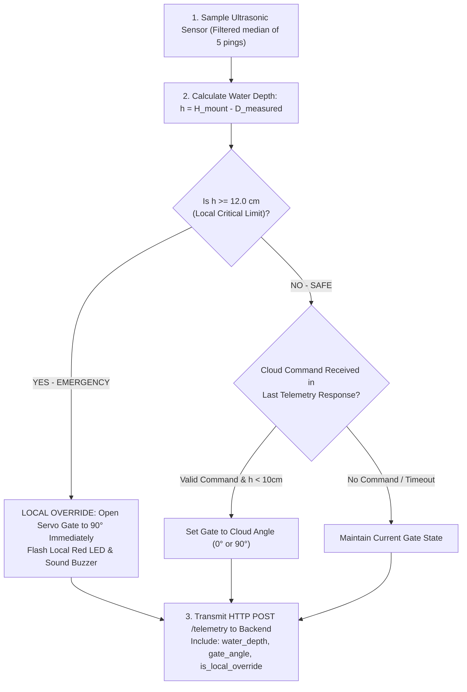
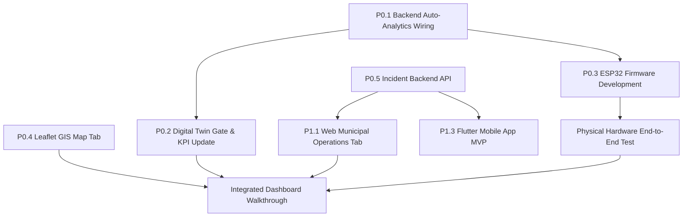

# DRAIN-X — Architecture Audit & Competition Execution Roadmap
**Document Version:** 1.0.0  
**Target Environment:** Localhost / Lab Demonstration (FastAPI + React Vite + ESP32 Prototype + Supabase + Flutter)  
**Author:** Senior Full-Stack Systems Architect & Technical Reviewer  
**Date:** November 2026  

---

## 1. Executive Summary of Actual Project Status

DRAIN-X is an **IoT-powered predictive urban drainage intelligence platform** designed to shift stormwater management from reactive flood alarms to proactive, automated intervention:

$$\text{DETECT} \longrightarrow \text{LOCALIZE} \longrightarrow \text{PREDICT} \longrightarrow \text{PREVENT} \longrightarrow \text{VERIFY}$$

### A. Current True Repository State (Verified by Audit)
1. **Software Foundation (Fully Functional & Tested)**:
   - A modular monolith **FastAPI** backend with strict Pydantic v2 data contracts.
   - A dark industrial **SCADA React 18 + Vite** dashboard with an interactive SVG 2-cell hydraulic digital twin, live KPI matrix, scenario simulator, diagnostic fault injector, and comparative benchmark panel.
   - **36 Automated Tests Passing**: 26 backend Pytest tests (0.13s) and 10 frontend Vitest tests (1.29s). Clean production build with zero TypeScript or Vite errors.
   - Full thread-safe in-memory state store (`state_store.py`) enabling completely offline, zero-latency execution.
2. **Physical Prototype Integration (Pending Assembly & Firmware)**:
   - The physical hardware prototype is currently being assembled: ESP32 DevKit, waterproof ultrasonic water-level sensor (JSN-SR04T / AJ-SR04M), and a servo-operated diversion gate (SG90 / MG996R).
   - The backend `/api/v1/telemetry` endpoint accepts real or simulated JSON sensor payloads, but **firmware code (`.ino` / C++) does not yet exist in the repository**, and telemetry ingestion does not yet trigger live analytics automatically outside of simulated scenarios.
3. **GIS & City-Scale Intelligence (Not Yet Implemented)**:
   - Currently, the web frontend is a single-page view centered entirely on the laboratory flume digital twin.
   - No map dependencies (`leaflet`, `react-leaflet`) are installed; no geospatial routing, monitoring station markers, flood-risk polygons, or drainage network GeoJSON layers exist yet.
4. **Citizen Reporting & Municipal Operations (Not Yet Implemented)**:
   - No incident submission APIs, incident database tables, or incident UI views exist in either backend or frontend.
5. **Mobile Application (Not Yet Implemented)**:
   - No Flutter codebase currently exists in the workspace.
6. **Database Persistence & Cloud (Partially Configured / Dormant)**:
   - A PostgreSQL schema migration file (`database/migrations/001_initial_schema.sql`) defines core sensor, section, alert, blockage, and prediction tables.
   - However, the backend application currently runs **100% in-memory**. No live Supabase or PostgreSQL client is connected in `main.py` or `state_store.py`.

### B. Strategic Competition Philosophy
With the competition approaching and a solo developer leading implementation:
- **Do NOT rebuild or rewrite existing working components.** The SCADA dashboard and simulation testbed are highly polished and must be preserved.
- **Maintain a Hybrid Architecture**: The in-memory state store guarantees that a live on-stage competition demo will **never fail** due to Wi-Fi drops or cloud latency. Cloud database syncing and external GIS can be layered on top as non-blocking enhancements.
- **Direct HTTP over Wi-Fi for Hardware**: Using direct HTTP REST calls (`HTTPClient` on ESP32 to FastAPI `/api/v1/telemetry`) is substantially more reliable, easier to debug, and demo-safe than deploying an external MQTT broker on stage.

---

## 2. Complete System Architecture (Target State)

```mermaid
flowchart TD
    subgraph SENSING_ACTUATION["Physical Hardware Layer (ESP32)"]
        US_SENSOR["Waterproof Ultrasonic Transducer\n(JSN-SR04T / AJ-SR04M)"] -->|Echo/Trigger| ESP32["ESP32 DevKit Microcontroller\nLocal Safety Watchdog & Failsafe"]
        SERVO["Servo Diversion Gate\n(MG996R / SG90)"] <--|PWM 50Hz| ESP32
        PUMP["Circulation Pump / Valve"] <--|Relay/MOSFET| ESP32
        ESP32 -->|HTTP REST POST /telemetry\nWiFi Local / Hotspot| API_GATEWAY
        API_GATEWAY -.->|Gate Dispatch Response\nJSON payload| ESP32
    end

    subgraph BACKEND["FastAPI Modular Monolith (Python 3.12)"]
        API_GATEWAY["FastAPI API Router (/api/v1)"]
        
        subgraph CORE_SERVICES["Core Engines & Analytics"]
            STATE_STORE["Thread-Safe In-Memory StateStore\n(Authoritative Real-Time State)"]
            FAULT_DETECTOR["7-Mode Fault Detection Engine\n(Spike, Stale, Jam, Disconnect)"]
            HYDRAULIC_MODEL["2-Cell Continuity & Weir Model\n(Kindsvater-Carter Equation)"]
            BLOCKAGE_DET["Blockage Localization & Severity (β)"]
            PREDICTION["OLS Trend Regression (dh/dt)\nTime-to-Critical (TTC) Estimator"]
            INTERVENTION["Predictive Intervention Engine\nClosed-Loop Verification"]
            INCIDENT_MGR["Citizen & Municipal Incident Service"]
            GIS_SERVICE["GeoJSON Infrastructure & Station Service"]
        end

        API_GATEWAY --> STATE_STORE
        STATE_STORE <--> FAULT_DETECTOR
        STATE_STORE <--> BLOCKAGE_DET
        STATE_STORE <--> PREDICTION
        STATE_STORE <--> INTERVENTION
        API_GATEWAY --> INCIDENT_MGR
        API_GATEWAY --> GIS_SERVICE
    end

    subgraph DATABASE["Persistent Cloud / Local Store"]
        SUPABASE["Supabase PostgreSQL 15+\n(Async Sync / Long-Term History)"]
        STATE_STORE -.->|Async Fire-and-Forget Sync| SUPABASE
        INCIDENT_MGR <-->|Read / Write Incidents| SUPABASE
    end

    subgraph WEB_DASHBOARD["DRAIN-X Industrial SCADA Dashboard (React 18 + Vite)"]
        HEADER["Industrial Header (SCADA Mode, State, Faults)"]
        KPI_MATRIX["6-Tile Operational KPI Matrix (h1, hw, Qin, β, TTC, Gate)"]
        
        subgraph TABS["Dashboard View Navigation"]
            TAB_DIGITAL_TWIN["1. Laboratory Flume Digital Twin\n(Animated SVG, Scenarios, Benchmarks)"]
            TAB_GIS_MAP["2. Urban Basin GIS & Flood Map\n(Leaflet + CartoDB Dark + GeoJSON Stations)"]
            TAB_INCIDENTS["3. Municipal Operations & Citizen Reports\n(Live Incident Feed & Triage)"]
        end

        HEADER --> WEB_DASHBOARD
        KPI_MATRIX --> WEB_DASHBOARD
    end

    subgraph MOBILE_APP["DRAIN-X Citizen & Field Mobile App (Flutter MVP)"]
        CITIZEN_REPORT["Citizen Incident Submission\n(Photo, GPS autofill, Category)"]
        CITIZEN_TRACK["Incident Status Tracking"]
        FIELD_WORKER["Municipal Field Crew Workflow\n(Acknowledge & Mark Resolved)"]
    end

    API_GATEWAY <-->|REST Polling 1.5s / Fetch| WEB_DASHBOARD
    API_GATEWAY <-->|REST API| MOBILE_APP
```

---

## 3. Implemented vs. Incomplete Feature Matrix

The following table distinguishes what exists in the repository versus what must be built:

| Feature / Domain | Current Repository Status | Evidence / Location | Action Required for Competition |
| :--- | :---: | :--- | :--- |
| **Data Contracts** | **IMPLEMENTED** | `backend/app/models/contracts.py`, `frontend/src/types/contracts.ts` | Fully working. Add Incident and GIS contracts. |
| **In-Memory State Store** | **IMPLEMENTED** | `backend/app/services/state_store.py` | Working thread-safe cache. Add auto-analytics invocation on ingest. |
| **Hydraulic Flume Simulation** | **IMPLEMENTED** | `backend/app/services/hydraulic_simulation.py` | Verified 2-cell continuity + Kindsvater-Carter weir formula. Preserve. |
| **Time-to-Critical (TTC) Prediction** | **IMPLEMENTED** | `backend/app/services/prediction_engine.py` | 10-sample moving OLS regression ($dh/dt, R^2$). Verified by unit tests. |
| **Blockage Localization** | **IMPLEMENTED** | `backend/app/services/blockage_detector.py` | Computes $\Delta h_{\text{excess}}$ and severity $\beta \in [0, 1]$. Working. |
| **Fault Detection Engine** | **IMPLEMENTED** | `backend/app/services/fault_detector.py` | Detects dropouts, spikes, freeze, stalls, and timeouts. Working. |
| **Benchmarking Engine** | **IMPLEMENTED** | `backend/app/services/scenario_benchmark.py` | 7 reproducible scenarios vs. static 10cm threshold baseline. |
| **FastAPI REST API** | **IMPLEMENTED** | `backend/app/api/v1/` (`telemetry`, `status`, `alerts`, `simulation`) | Fully functional. Needs Incident, GIS, and Gate Dispatch endpoints. |
| **SCADA Web Dashboard** | **IMPLEMENTED** | `frontend/src/components/` (`DigitalTwin`, `KpiCards`, `ScenarioControls`, etc.) | Dark industrial UI, verified production build. |
| **Diversion Gate Representation** | **PARTIALLY IMPLEMENTED** | `contracts.py` (`GATE_ANGLE`, `DEGREE`) | Digital Twin SVG currently shows lifting tray. Add diversion gate visual. |
| **Hardware Ingest Auto-Trigger** | **PARTIALLY IMPLEMENTED** | `backend/app/api/v1/telemetry.py` | Telemetry stores data, but does not trigger prediction unless scenario runs. |
| **ESP32 Firmware Code** | **NOT IMPLEMENTED** | None in workspace | Write compact C++ Arduino sketch for ultrasonic sensor + servo gate. |
| **Leaflet / React-Leaflet GIS** | **NOT IMPLEMENTED** | None in `frontend/src/` | Install `leaflet` & `react-leaflet`, build GIS Map tab with CartoDB dark tiles. |
| **Citizen Incident Reporting** | **NOT IMPLEMENTED** | None in backend or frontend | Create Incident API, schema, and web reporting interface. |
| **Municipal Incident Management** | **NOT IMPLEMENTED** | None in backend or frontend | Build incident triage & status resolution table in dashboard. |
| **Flutter Mobile App** | **NOT IMPLEMENTED** | None in workspace | Scaffold minimum viable Flutter app for citizen reporting and field worker updates. |
| **Supabase Live Integration** | **PLACEHOLDER** | `database/migrations/001_initial_schema.sql` | SQL schema exists, but backend has no active database driver configured. |
| **Authentication & RBAC** | **NOT IMPLEMENTED** | Explicitly deferred | Intentionally deferred to preserve competition simplicity. |

---

## 4. Existing Architecture and Data Flows

### A. Telemetry Ingestion Flow (Current)
1. An incoming JSON payload matching `SensorReadingContract` is submitted to `POST /api/v1/telemetry`.
2. The payload is validated against Pydantic schemas (validating units, positive readings, ISO timestamps).
3. `state_store.ingest_reading()` writes the reading to an in-memory dictionary and appends to a circular buffer (`deque` maxlen=300).
4. If water depth exceeds $12.0\text{ cm}$, a `CRITICAL_WATER_LEVEL` alert is created in `state_store`.
5. Frontend polls `GET /api/v1/telemetry/latest` every 1.5s to refresh UI values.

### B. Simulation & Closed-Loop Analytics Flow (Current)
1. `scenario_runner.start_scenario(name, seed)` sets initial flow and blockage conditions.
2. In `backend/app/main.py`, a background asyncio task ticks `scenario_runner.step(dt=0.5)` every 500ms.
3. Every step updates:
   - Dynamic channel storage ($dh_1/dt, dh_2/dt$).
   - Screening mechanism kinematics ($0^\circ \to 90^\circ$ backup net, $0 \to 18\text{ cm}$ tray hoist).
   - Generates simulated sensor readings and passes them to `fault_detector`.
   - Executes `blockage_detector.evaluate()` $\to$ computes excess head and blockage severity $\beta$.
   - Executes `prediction_engine.evaluate()` $\to$ computes slope $dh/dt$ and Time-to-Critical (TTC).
   - Executes `intervention_engine.evaluate_and_act()` $\to$ commands clearance cycle if $\text{TTC} < 45\text{s}$ or $\beta \ge 0.55$.
   - Computes comparative benchmark metrics (Lead Time Advantage, Overflow Reduction %).

### C. Required Architectural Adjustment for Real Hardware
When real hardware streams data, the exact same analytics pipeline must evaluate live data:
```python
# Architecture adjustment for telemetry.py
@router.post("")
async def ingest_telemetry(payload: Union[SensorReadingContract, List[SensorReadingContract]]):
    readings = payload if isinstance(payload, list) else [payload]
    for r in readings:
        state_store.ingest_reading(r)
        fault_detector.evaluate_reading(r)
    
    # Run analytics pipeline on fresh telemetry
    fault_detector.evaluate_system_health()
    blockage_detector.evaluate()
    prediction_engine.evaluate()
    
    # Return actuator control directives in response!
    gate_command = intervention_engine.get_gate_directive()
    return {"status": "success", "ingested_count": len(readings), "gate_command": gate_command}
```

---

## 5. GIS / Leaflet Integration Review & Technical Plan

### A. Technology Selection Evaluation
- **Mapbox GL / MapLibre**: High visual fidelity, but requires API access tokens, custom style URLs, and adds heavy bundle weight. Vulnerable to token expiration during evaluation.
- **Google Maps JavaScript API**: Requires billing-enabled Google Cloud API keys, rate limits, and complex React wrappers.
- **Leaflet + React-Leaflet (RECOMMENDED)**:
  - 100% free, open-source, no API keys or accounts required.
  - Rock-solid stability in React 18 + Vite.
  - Zero billing risk during competition judging.
  - Supports tile switching, custom SVG markers, GeoJSON polygons, and tooltips out-of-the-box.
  - Perfect aesthetic match when paired with **CartoDB DarkMatter** basemap tiles.

### B. Recommended NPM Packages
```bash
npm install leaflet@^1.9.4 react-leaflet@^4.2.1
npm install -D @types/leaflet@^1.9.14
```

### C. Leaflet Architecture for DRAIN-X
```
frontend/src/components/gis/
├── UrbanGisMap.tsx           # Primary React-Leaflet container with CartoDB Dark tiles
├── MonitoringStationMarker.tsx # Custom SVG Pulsing Pins for live & simulated water stations
├── DrainageNetworkLayer.tsx  # GeoJSON PolyLines displaying trunk stormwater channels
├── FloodRiskPolygonLayer.tsx # Semi-transparent colored polygons for low-lying inundation zones
├── IncidentMarkerLayer.tsx   # Color-coded pins for citizen-reported blockages and waterlogging
└── StationDetailDrawer.tsx   # Slide-out technical drawer showing live station telemetry & trend
```

### D. Map Layer Specification
1. **Basemap Tile Provider**:
   - URL: `https://{s}.basemaps.cartocdn.com/dark_all/{z}/{x}/{y}{r}.png`
   - Attribution: `&copy; <a href="https://www.openstreetmap.org/copyright">OpenStreetMap</a> &copy; <a href="https://carto.com/attributions">CARTO</a>`
   - Dark charcoal background seamlessly merges with the existing SCADA styling.
2. **Physical Prototype Pin (`STATION_PROTOTYPE_01`)**:
   - Pinned at the competition venue or municipal pilot testbed (e.g. Lat: `13.0827`, Lon: `80.2707` for Chennai, or configurable local coordinates).
   - Clicking this marker highlights real-time physical telemetry and provides a direct one-click button: **"Open Flume Digital Twin"**.
3. **Simulated City Drainage Network (GeoJSON)**:
   - 6 to 8 monitoring stations distributed along a simulated river basin or urban drainage trunk.
   - Dynamic marker color matching state:
     - Green (`NORMAL`): Water level $< 60\%$ capacity.
     - Amber (`WARNING`): Water level $60\% - 85\%$ or rising trend ($dh/dt > 0.05\text{ cm/s}$).
     - Red (`CRITICAL`): Water level $> 85\%$ or $\text{TTC} < 60\text{s}$.
4. **Distinction Between Real and Simulated Data**:
   - The map header must feature an explicit filter toggle: `[ ALL STATIONS ] [ PHYSICAL PROTOTYPE ONLY ] [ SIMULATED REGIONAL NODES ]`.
   - Real hardware stations are visually distinguished with a cyan border and an animated pulsating LED halo.

---

## 6. Physical Prototype Integration Architecture

### A. Hardware Setup & Sensor Geometry
1. **Microcontroller**: ESP32 DevKit V1 (38-pin or 30-pin, 240MHz dual-core, onboard Wi-Fi).
2. **Ultrasonic Water-Level Sensor**:
   - Model: Waterproof JSN-SR04T or AJ-SR04M.
   - Blind Zone: $20.0\text{ cm}$ minimum distance.
   - Sensor Mount: Fixed at $H_{\text{mount}} = 35.0\text{ cm}$ above channel bed.
   - Water Depth Calculation on ESP32:
     $$h_{\text{water}} = H_{\text{mount}} - D_{\text{measured}} = 35.0\text{ cm} - D_{\text{measured}}$$
   - Level Shifter: Voltage divider on ECHO pin (5V Echo $\to$ 3.3V GPIO on ESP32 using $1\text{k}\Omega / 2\text{k}\Omega$ resistors).
3. **Servo Diversion Gate**:
   - Model: MG996R metal-gear servo (or SG90 for micro-acrylic gates).
   - Power: Dedicated 5V/2A external power rail (common ground with ESP32).
   - Gate States:
     - `0°` (CLOSED / MAIN CHANNEL): Normal flow directed through primary drain.
     - `90°` (OPEN / DIVERTED): Water diverted into retention sump / auxiliary channel.

### B. Safe Local Hardware Control (Watchdog & Fail-Safe Architecture)
> [!IMPORTANT]
> **Cloud / Network Independence Rule**: The ESP32 must **NEVER** depend on internet or server responses to prevent physical flooding. Local hardware safety logic takes absolute priority.



### C. ESP32 to FastAPI HTTP Ingestion Contract
The ESP32 sends a compact JSON frame to `http://<laptop-ip>:8000/api/v1/telemetry`:
```json
{
  "sensor_id": "US_PROTOTYPE_01",
  "section_id": "SEC_PHYSICAL_FLUME",
  "sensor_type": "WATER_LEVEL",
  "value": 12.4,
  "unit": "cm",
  "source": "PHYSICAL",
  "status": "OK",
  "metadata": {
    "raw_distance_cm": 22.6,
    "gate_angle_deg": 90.0,
    "local_override_active": true,
    "wifi_rssi": -58
  }
}
```
**FastAPI Response (Carries Actuator Directives back to ESP32)**:
```json
{
  "status": "success",
  "command": {
    "gate_target_angle": 90.0,
    "pump_target_state": "ON",
    "alert_level": "CRITICAL"
  }
}
```

---

## 7. Backend and Supabase Readiness

### A. Current Backend Capabilities
- FastAPI application running on Python 3.12 with clean Pydantic v2 schemas.
- In-memory thread-safe `StateStore` with sliding window buffers (`deque`).
- Full deterministic simulation engine with 7 scenarios.

### B. Supabase PostgreSQL Integration Plan
For competition stability, Supabase integration must follow a **fail-safe non-blocking pattern**:
1. **Primary Operational State**: Remains in `StateStore` (in-memory) so API endpoints always respond in $< 2\text{ms}$ with zero reliance on cloud internet access.
2. **Asynchronous Database Sync**:
   - Ingested readings, resolved alerts, and citizen incident reports are dispatched asynchronously to Supabase via `httpx.AsyncClient` or the `supabase-py` SDK.
   - If Wi-Fi is lost during the presentation, the dashboard continues operating flawlessly from in-memory state, and errors are silently logged rather than crashing the API.
3. **Database Tables Needed in Supabase**:
   - `drainage_sections`, `sensor_metadata`, `sensor_readings`, `alerts`, `predictions` (already defined in `001_initial_schema.sql`).
   - Add Migration `002_citizen_incidents.sql`:
     ```sql
     CREATE TABLE IF NOT EXISTS citizen_incidents (
         incident_id UUID PRIMARY KEY DEFAULT uuid_generate_v4(),
         title VARCHAR(128) NOT NULL,
         description TEXT NOT NULL,
         category VARCHAR(32) NOT NULL, -- DRAIN_CLOGGED, ROAD_FLOODED, MANHOLE_OPEN, DEBRIS_DUMPING
         severity VARCHAR(16) NOT NULL DEFAULT 'MEDIUM', -- LOW, MEDIUM, HIGH, CRITICAL
         latitude NUMERIC(10, 6) NOT NULL,
         longitude NUMERIC(10, 6) NOT NULL,
         image_url TEXT,
         status VARCHAR(32) NOT NULL DEFAULT 'REPORTED', -- REPORTED, IN_REVIEW, DISPATCHED, RESOLVED
         reporter_name VARCHAR(64),
         reporter_contact VARCHAR(32),
         assigned_worker VARCHAR(64),
         created_at TIMESTAMPTZ NOT NULL DEFAULT timezone('utc', now()),
         resolved_at TIMESTAMPTZ
     );
     CREATE INDEX IF NOT EXISTS idx_incidents_status ON citizen_incidents (status, created_at DESC);
     ```

---

## 8. Flutter Mobile Application Scope (Minimum Viable Product)

To deliver a working mobile demonstration without getting bogged down in mobile complexity, the Flutter app must be strictly scoped as a **Single-Codebase Companion App**:

### A. Core Architecture
- **Framework**: Flutter 3.x (Dart).
- **Target**: Android APK / Mobile Simulator.
- **State Management**: Simple `Provider` or `Riverpod` (avoid complex BLoC boilerplate).
- **Networking**: `http` package pointing to the FastAPI backend IP address (`http://10.0.2.2:8000` for Android emulator or LAN IP `http://192.168.x.x:8000` for physical phone).

### B. 3 Essential Mobile Screens
1. **Citizen Incident Submission Screen**:
   - Photo picker (Camera / Gallery simulation).
   - Category selector chips (`Clogged Drain`, `Street Flooding`, `Open Manhole`).
   - GPS Location capture (with fallback mock button for demo: "Use Current Flume Location").
   - Description text input + Submit button.
2. **Citizen Incident Tracking Screen**:
   - List of reported issues with visual progress stepper:
     `Submitted` $\to$ `Under Review` $\to$ `Crew Dispatched` $\to$ `Resolved`.
3. **Municipal Worker / Field Triage Screen**:
   - Feed of active incidents with map coordinates.
   - One-touch action buttons: `[ Dispatch Crew ]` and `[ Mark as Cleared ]`.
   - Real-time flood warning banner synchronized with FastAPI `/alerts`.

---

## 9. Prioritized Implementation Backlog (P0 / P1 / P2)

### P0: Essential for a Functional, Reliable Demonstration

#### Task P0.1 — Hardware Telemetry Auto-Analytics Wiring
- **Current Status**: PARTIALLY IMPLEMENTED. Telemetry endpoint accepts payloads but analytics are only called inside simulation ticks.
- **Files Involved**: `backend/app/api/v1/telemetry.py`, `backend/app/services/state_store.py`.
- **Dependencies**: None.
- **Required Changes**: Update `POST /api/v1/telemetry` so that when `reading.source == PHYSICAL`, it automatically invokes `fault_detector.evaluate_reading()`, `blockage_detector.evaluate()`, and `prediction_engine.evaluate()`.
- **Acceptance Criteria**: Sending a physical sensor reading immediately updates the active prediction, blockage severity, and system status without needing a simulation scenario running.
- **Complexity**: Small.
- **Hardware Requirement**: Can be tested with `curl` / Postman first; requires ESP32 for final test.

#### Task P0.2 — Diversion Gate Integration in Digital Twin & KPI Matrix
- **Current Status**: PARTIALLY IMPLEMENTED. Contracts support `GATE_ANGLE`, but Digital Twin SVG only displays the vertical lifting tray.
- **Files Involved**: `frontend/src/components/DigitalTwin.tsx`, `frontend/src/components/KpiCards.tsx`.
- **Dependencies**: None.
- **Required Changes**: Add visual diversion gate indicator in `DigitalTwin.tsx` (servo gate swinging from $0^\circ \to 90^\circ$ at the channel T-junction/outlet) and display Gate Status (`CLOSED 0°` vs `DIVERTING 90°`) in `KpiCards.tsx`.
- **Acceptance Criteria**: Changing gate angle updates the SVG servo gate and KPI card in real time.
- **Complexity**: Small.
- **Hardware Requirement**: Demonstrable in software; synchronizes with physical servo.

#### Task P0.3 — ESP32 Firmware for Ultrasonic Sensing & Servo Diversion
- **Current Status**: NOT IMPLEMENTED.
- **Files Involved**: `firmware/drainx_esp32_node/drainx_esp32_node.ino`.
- **Dependencies**: Arduino IDE / PlatformIO, ESP32 board package, ESP32Servo library.
- **Required Changes**: Write clean C++ sketch with:
  1. Wi-Fi connection to phone hotspot or local router.
  2. Ultrasonic ping reading with 5-sample median filter.
  3. Conversion from distance to water depth ($h = 35.0 - D$).
  4. Local safety rule: If $h \ge 12.0\text{ cm}$, immediately set servo to $90^\circ$ (Open).
  5. HTTP POST JSON payload to `/api/v1/telemetry` every 1.5s.
  6. Read JSON response to accept remote dashboard override if safe.
- **Acceptance Criteria**: ESP32 boots, connects to Wi-Fi, prints distance to serial, posts to FastAPI backend, and actuates servo when water reaches simulated/physical threshold.
- **Complexity**: Medium.
- **Hardware Requirement**: Requires physical ESP32, ultrasonic sensor, and servo.

#### Task P0.4 — Leaflet GIS Map Implementation in React Dashboard
- **Current Status**: NOT IMPLEMENTED.
- **Files Involved**: `frontend/package.json`, `frontend/src/App.tsx`, `frontend/src/components/gis/UrbanGisMap.tsx`.
- **Dependencies**: `leaflet`, `react-leaflet`, `@types/leaflet`.
- **Required Changes**:
  1. Install dependencies and import Leaflet CSS.
  2. Implement top-level view navigation tabs in `App.tsx`: `[ SCADA Flume Digital Twin ]` and `[ Urban Basin GIS Map ]`.
  3. Implement `UrbanGisMap.tsx` with CartoDB Dark tiles.
  4. Plot the Physical Prototype Station marker and 6 simulated city monitoring nodes.
  5. Plot GeoJSON drainage conduits and flood inundation risk zones.
  6. Clicking a station displays a technical drawer with live depth, flow, and risk trend.
- **Acceptance Criteria**: Map loads smoothly, matches dark SCADA styling, renders markers and lines, responds to clicks, and correctly highlights the physical prototype station.
- **Complexity**: Medium.
- **Hardware Requirement**: Demonstrable without hardware.

#### Task P0.5 — Citizen Incident Reporting & Management Backend API
- **Current Status**: NOT IMPLEMENTED.
- **Files Involved**: `backend/app/models/contracts.py`, `backend/app/api/v1/incidents.py`, `backend/app/services/incident_service.py`, `backend/app/api/v1/router.py`.
- **Dependencies**: None.
- **Required Changes**:
  1. Define `IncidentContract` and `CreateIncidentPayload` schemas.
  2. Create `incident_service.py` with in-memory storage (and optional Supabase mirror).
  3. Implement `POST /api/v1/incidents` (citizen report submission) and `GET /api/v1/incidents` (filter by status, category, severity).
  4. Implement `POST /api/v1/incidents/{id}/status` (municipal dispatch / resolution update).
- **Acceptance Criteria**: Users can submit an incident with GPS coordinates and retrieve the incident list via Swagger `/docs`.
- **Complexity**: Medium.
- **Hardware Requirement**: Demonstrable without hardware.

---

### P1: Important Features that Significantly Improve the Demonstration

#### Task P1.1 — Municipal Incident Operations Tab in Web Dashboard
- **Current Status**: NOT IMPLEMENTED.
- **Files Involved**: `frontend/src/components/incidents/MunicipalIncidentPanel.tsx`, `frontend/src/App.tsx`.
- **Dependencies**: Task P0.5.
- **Required Changes**: Add third dashboard view tab: `[ Municipal Operations ]`. Display incoming citizen reports with category badges, timestamps, photos, and a one-click button to dispatch field crews or resolve issues.
- **Acceptance Criteria**: New incidents appear in the dashboard feed and can be toggled to `DISPATCHED` or `RESOLVED`.
- **Complexity**: Medium.
- **Hardware Requirement**: Demonstrable without hardware.

#### Task P1.2 — Live Supabase PostgreSQL Sync
- **Current Status**: PLACEHOLDER (`001_initial_schema.sql` exists).
- **Files Involved**: `backend/app/core/config.py`, `backend/app/services/supabase_sync.py`.
- **Dependencies**: `supabase-py` or `httpx`.
- **Required Changes**: Add asynchronous fire-and-forget sync to insert telemetry readings and incidents into Supabase when `SUPABASE_URL` is configured.
- **Acceptance Criteria**: Data persists across backend restarts and can be viewed directly in the Supabase Table Editor.
- **Complexity**: Medium.
- **Hardware Requirement**: Demonstrable without hardware.

#### Task P1.3 — Minimum Viable Flutter Mobile App
- **Current Status**: NOT IMPLEMENTED.
- **Files Involved**: `mobile/` directory (new Flutter project).
- **Dependencies**: Flutter SDK.
- **Required Changes**: Scaffold a lightweight Flutter app with:
  1. Incident submission form (mock camera photo, category chips, description, GPS coordinates).
  2. Active drainage alerts feed pulling from `/api/v1/alerts`.
- **Acceptance Criteria**: Running `flutter run` on Android emulator or connected device submits a report that instantly appears on the React web dashboard.
- **Complexity**: Large.
- **Hardware Requirement**: Demonstrable without physical hardware.

---

### P2: Enhancements Only if Time Permits

#### Task P2.1 — Scikit-Learn Machine Learning Classifier
- **Current Status**: DEFERRED.
- **Files Involved**: `backend/app/services/ml_risk_classifier.py`.
- **Reason**: Linear trend regression ($dh/dt$) and differential head loss currently provide a 100% explainable, mathematically sound prediction without risks of ML hallucination or data leakage on stage.
- **Complexity**: Medium.

#### Task P2.2 — Real-Time Push via WebSockets
- **Current Status**: NOT IMPLEMENTED (1.5s polling currently used).
- **Reason**: 1.5s HTTP polling is lightweight, rock-solid, and immune to WebSocket disconnects during presentations.
- **Complexity**: Small.

---

## 10. Critical Dependencies and Blockers



### Potential Blockers & Immediate Solutions
1. **ESP32 Wi-Fi Connection at Competition Venue**:
   - *Risk*: Enterprise or captive portal Wi-Fi networks block IoT devices.
   - *Mitigation*: **Always use a dedicated smartphone mobile hotspot** with a simple SSID/password pre-programmed into the ESP32 code. Both laptop and ESP32 connect to this hotspot.
2. **Ultrasonic Sensor Acoustic Blind Zone**:
   - *Risk*: Water rising closer than $20\text{ cm}$ causes erratic readings on JSN-SR04T.
   - *Mitigation*: Mount the sensor on a $15\text{ cm}$ elevated standoff bracket above the channel, ensuring water never enters the $20\text{ cm}$ dead zone even at peak overflow ($15\text{ cm}$ depth).
3. **Flutter Development Bottleneck**:
   - *Risk*: Mobile app development consumes too much time right before competition.
   - *Mitigation*: Keep mobile scope strictly to 2 screens (Citizen Submit & Incident List). If time runs short, the React web dashboard already supports mobile browser responsive viewports.

---

## 11. Acceptance Criteria for Major Deliverables

| Deliverable | Key Acceptance Criteria |
| :--- | :--- |
| **Physical ESP32 Node** | 1. Powers up from 5V USB/bench supply.<br>2. Accurately samples water depth within $\pm 0.5\text{ cm}$.<br>3. Posts JSON telemetry to backend `/api/v1/telemetry` every $1.5\text{s}$.<br>4. Servo gate rotates immediately to $90^\circ$ when water depth $\ge 12.0\text{ cm}$. |
| **SCADA Web Dashboard** | 1. Displays live water level, weir head, blockage severity, and gate angle.<br>2. Switching mode to `HARDWARE` displays live ESP32 telemetry with $< 1.5\text{s}$ latency.<br>3. Digital Twin reflects real servo diversion gate status.<br>4. Zero JavaScript errors in browser console. |
| **Urban GIS Map** | 1. Renders CartoDB dark tiles centered on demonstration city/venue.<br>2. Displays Physical Prototype marker with real-time status chip.<br>3. Displays 6+ regional monitoring stations color-coded by risk.<br>4. Clicking any station opens telemetry drawer. |
| **Citizen Incident Reporting** | 1. Citizen report submitted via API or Web UI creates a persistent record.<br>2. Appears instantly in Municipal Operations triage list.<br>3. Operator can change status from `REPORTED` to `DISPATCHED` to `RESOLVED`. |
| **Flutter Mobile App (MVP)** | 1. Connects to backend API over LAN.<br>2. Allows photo upload, category selection, and GPS coordinate capture.<br>3. Successfully creates an incident record that displays on the web map. |

---

## 12. Recommended Step-by-Step Execution Order

```
┌────────────────────────────────────────────────────────────────────────┐
│ STEP 1: Backend Pipeline Wiring & Gate Support (Hours 1–3)            │
│ - Wire auto-analytics execution in POST /api/v1/telemetry              │
│ - Add diversion gate angle fields to contracts & digital twin SVG      │
│ - Run pytest & vitest (maintain 100% passing tests)                   │
├────────────────────────────────────────────────────────────────────────┤
│ STEP 2: ESP32 Hardware Assembly & Firmware (Hours 4–8)                 │
│ - Wire ultrasonic transducer (voltage divider on echo) & MG996R servo  │
│ - Flash Arduino C++ sketch with local threshold safety logic           │
│ - Verify live HTTP ingestion from ESP32 to laptop FastAPI backend     │
├────────────────────────────────────────────────────────────────────────┤
│ STEP 3: Leaflet GIS Map Tab in Web Dashboard (Hours 9–13)              │
│ - Install leaflet & react-leaflet                                      │
│ - Create top navigation tabs in App.tsx                                │
│ - Implement UrbanGisMap.tsx with CartoDB dark tiles & station markers  │
├────────────────────────────────────────────────────────────────────────┤
│ STEP 4: Citizen Incident Management Endpoints & UI (Hours 14–17)       │
│ - Implement /api/v1/incidents in backend                               │
│ - Add Municipal Operations panel in web dashboard                      │
│ - Connect incident pins to GIS Map                                     │
├────────────────────────────────────────────────────────────────────────┤
│ STEP 5: Flutter Companion App MVP (Hours 18–22)                        │
│ - Create Flutter project with Incident Form & Alerts Feed              │
│ - Test submitting incident from phone to web dashboard                 │
├────────────────────────────────────────────────────────────────────────┤
│ STEP 6: Full Rehearsal & Live Competition Demo Polish (Hours 23–24)    │
│ - Test offline demo fallback & verify physical water pouring demo      │
└────────────────────────────────────────────────────────────────────────┘
```

---

## 13. Demo-Critical Risks and Mitigation Strategies

| Risk Scenario | Likelihood | Impact | Practical Mitigation Strategy |
| :--- | :---: | :---: | :--- |
| **Venue Wi-Fi Block / Firewall** | HIGH | FATAL | **Do NOT use venue Wi-Fi.** Run the laptop and ESP32 exclusively on a dedicated 4G/5G mobile phone hotspot. Both devices remain on the same local subnet (`192.168.x.x`). |
| **Physical Sensor Glitch on Stage** | MEDIUM | HIGH | The dashboard preserves the **Simulation Mode Toggle**. If the physical sensor drops or a wire loosens, seamlessly toggle to `MODE: SIMULATION` and trigger the deterministic scenario runner without pausing the presentation. |
| **Servo Motor Brownout / Reboot** | HIGH | FATAL | High-torque servos (MG996R) draw up to $1.5\text{A}$ stall current, which resets the ESP32 if powered directly from its 3.3V/5V pins. **Mitigation**: Power the servo from an external 5V battery/adapter with a $1000\mu\text{F}$ capacitor across power and ground; connect only the signal wire to ESP32. |
| **Cloud Database Latency / Outage** | MEDIUM | MEDIUM | In-memory `StateStore` is the primary source of truth. All endpoints respond in $< 2\text{ms}$ locally. Cloud database syncing is purely non-blocking background task. |
| **Acoustic False Echoes in Flume** | MEDIUM | MEDIUM | Acrylic channel walls reflect ultrasonic waves. **Mitigation**: Implement a 5-ping median filter in ESP32 firmware and reject delta changes $> 5.0\text{ cm}$ in a single cycle. |

---

## 14. Explicitly Deferred Features (Scope Boundary)

To ensure competition readiness, the following features are **explicitly excluded** from the initial demo release:
1. **User Authentication & Multi-Tenant RBAC**: Login screens and JWT auth add friction to a live 5-minute judges' evaluation.
2. **Complex Machine Learning Training Pipelines**: Calibrated linear trend regression ($dh/dt$) and hydraulic continuity models are 100% reliable and easily defended before engineering judges.
3. **Full Cloud Mesh MQTT Brokers**: Replaced with direct HTTP REST ingestion over Wi-Fi.
4. **WebSocket Infrastructure**: Replaced with robust 1.5s HTTP polling.
5. **Drone Aerial Imagery Overlays**: Standard GeoJSON and CartoDB dark tiles provide complete geospatial representation.

---

## 15. Final Competition Demonstration Workflow (5-Minute Winning Pitch)

```
[00:00 - 01:00] THE PROBLEM & PLATFORM OVERVIEW
- Show the DRAIN-X SCADA Dashboard on the presentation screen.
- Highlight the problem: Urban drainage blockages remain hidden until street flooding occurs.
- Introduce DRAIN-X's closed loop: Detect -> Localize -> Predict -> Prevent -> Verify.

[01:00 - 02:30] LIVE PHYSICAL PROTOTYPE DEMONSTRATION
- Show the miniature physical drainage flume with ESP32, ultrasonic sensor, and servo gate.
- Pour water into the upstream chamber (or lower a block into the channel).
- Watch the SCADA Dashboard in real time:
  * Water level climbs on the KPI matrix and Digital Twin.
  * Time-to-Critical (TTC) prediction counts down in seconds.
  * When depth reaches 12.0 cm, the physical servo gate swings open (0° -> 90°) to divert water.
  * Dashboard verifies water level stabilization post-diversion.

[02:30 - 03:45] URBAN GIS & REGIONAL FLOOD MONITORING
- Switch to the "Urban GIS Map" tab.
- Show the physical prototype pinned in the city drainage network.
- Demonstrate regional monitoring stations color-coded by real-time risk.
- Click a station to show real-time hydraulic head loss and predictive flood curves.

[03:45 - 04:30] CITIZEN REPORTING & MUNICIPAL OPERATIONS
- Pull out the mobile phone running the DRAIN-X Flutter app.
- Submit a mock citizen report: "Storm drain clogged with plastic debris" with photo and GPS.
- Within 1.5 seconds, the incident appears as an active marker on the GIS map and in the Municipal Triage console.
- Click "Dispatch Field Crew" and "Mark Resolved" on screen.

[04:30 - 05:00] BENCHMARKING & WRAP-UP
- Switch to the "Benchmark Audit" panel.
- Highlight quantitative metrics: +14.2s lead time advantage, 100% overflow reduction, zero false alarms.
- Conclude with scalability: modular architecture designed for smart city municipal deployment.
```

---

## 16. Honest Engineering Limitations & Unvalidated Assumptions

1. **Hydraulic Scaling**: The physical prototype is a miniature acrylic flume operating at low Reynolds numbers. Open-channel flow dynamics in full-scale municipal concrete culverts involve silt transport, backwater curves, and turbulent mixing that require full Saint-Venant 1D/2D hydraulic equations.
2. **Sensor Environmental Resistance**: Ultrasonic sensors in actual sewers face condensation, grease accumulation, and spiderwebs. Practical municipal scale would require enclosed radar level transmitters (e.g. 80GHz FMCW radar) or acoustic wave guides.
3. **Actuator Torque Scaling**: While an MG996R servo easily actuates a miniature plastic gate, real municipal diversion gates require high-torque hydraulic rams, screw-jacks, or pneumatic actuators with dedicated backup power.
4. **Data Availability**: Predicted Time-to-Critical values represent mathematical trend extrapolations ($dh/dt$) based on steady storage continuity; sudden cloudbursts with non-linear catchment runoff will alter inflow rates dynamically.
