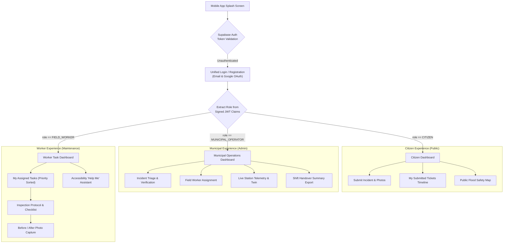
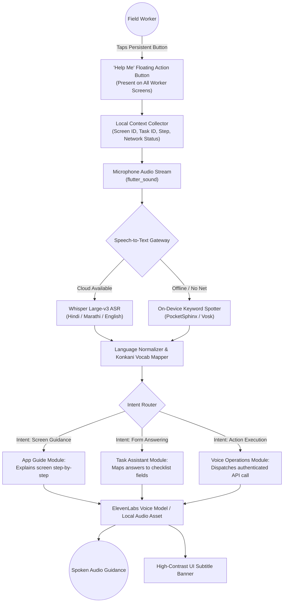
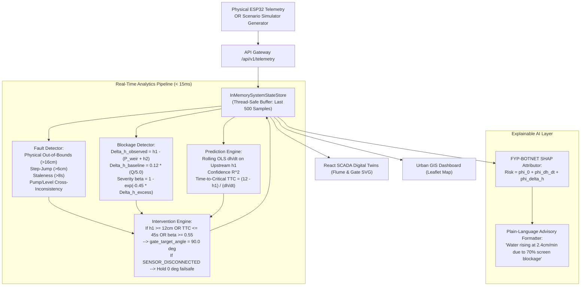
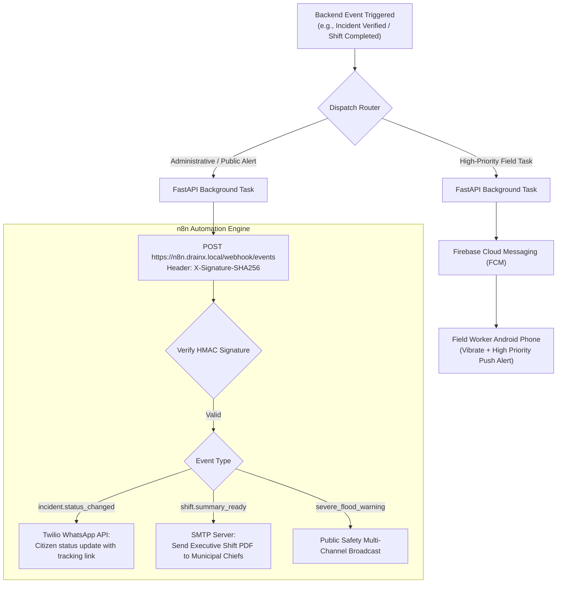
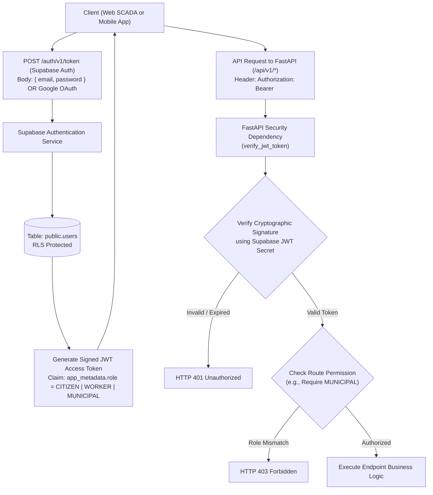

# DRAIN-X — Comprehensive System Architecture & Reference Repository Integration Audit

**Document Version:** 2.0.0  
**Status:** Architectural Specification & Engineering Audit Report (READ-ONLY BASELINE)  
**Authors:** Principal Systems Architect, Senior IoT/Embedded Engineer, AI/ML Specialist, GIS Engineer, Mobile Solutions Architect, Cybersecurity Reviewer  
**Date:** November 2026  
**Target Environment:** Localhost / Lab Demonstration Testbed & Scalable Urban Cloud Architecture  

---

## 1. Executive Summary

DRAIN-X is an **Integrated Predictive Urban Drainage Intelligence & Citizen Response Platform** designed to solve a foundational municipal and environmental challenge: transforming urban flood and stormwater operations from slow, reactive emergency pumping into proactive, automated, verified risk mitigation.

$$\text{SENSE (IoT)} \longrightarrow \text{DETECT (Physics/AI)} \longrightarrow \text{PREDICT (TTC)} \longrightarrow \text{ACTUATE (Servo/Winch)} \longrightarrow \text{VERIFY (Closed-Loop)} \longrightarrow \text{COORDINATE (GIS/Citizen/Field)}$$

### 1.1 Dual-Environment Design Paradigm
A primary architectural principle established by this audit is the strict separation between:
1. **The Physical Demonstrator Testbed**: A miniature physical rig designed for proof-of-concept validation and live judges' demonstration. It comprises an ESP32 DevKit, a JSN-SR04T waterproof ultrasonic level sensor, a YFS201 flow sensor, and an SG90/MG996R servo-operated diversion gate on a miniature cardboard/PVC dual-channel flume. It has physical constraints: limited sensors, low flow, and strict safety rules (including dry demonstration contingency).
2. **The City-Scale Software System & Digital Twin**: A software architecture capable of simulating dozens of drainage nodes across a municipality (such as Panaji, Goa), running multi-sensor hydraulic mass-balance simulations, tracking citizen incident tickets, dispatching field crews, visualizing flood hazards on GIS, and evaluating AI-assisted blockage and risk severity models.

**The software platform does NOT depend on hundreds of physical sensors to deliver high-value capabilities.** Software simulation, synthetic telemetry generation, digital twin visualization, and clear labelling of live vs. synthetic data allow rich demonstration while keeping the physical prototype simple, robust, and reliable.

### 1.2 Key Audit Findings at a Glance
- **Software Foundation is Robust**: The existing FastAPI modular monolith and React 18 SCADA frontend are cleanly structured with 46 passing backend pytest tests and 33 passing frontend vitest tests. The in-memory state store guarantees zero-latency, cloud-independent demonstration.
- **Physical Integration is Ingest-Ready**: Hardware endpoint `POST /api/v1/telemetry` connects incoming physical sensor packets directly to fault detection, blockage calculation, linear regression TTC prediction, and gate directive computation.
- **Demonstration Resilience Must Be Protected**: Background simulation loops and physical telemetry ingestion currently write to the same in-memory state store singleton, presenting a risk of state collision if both run simultaneously.
- **10 Reference Repositories Synthesized**: High-value engineering techniques from 10 reference repositories (UrbanEye-AI, MedTranslate, KhatKhat, Audit-AI, Trust-Bus, Meeting Architect, SLM-with-OLLAMA, IDEAS4.0, KaamSetu, and FYP-BOTNET) have been filtered, adapted, and consolidated into an actionable roadmap without bloat.

---

## 2. Existing Architecture Audit

### 2.1 Backend Architecture
- **Framework**: FastAPI (Python 3.12) organized as a modular monolith in `backend/app/`.
- **Validation & Contracts**: Pydantic v2 data models defined in `app/models/contracts.py` enforce schemas for sensor readings, alerts, blockages, predictions, actuator directives, and incidents.
- **State Storage**: `InMemorySystemStateStore` in `app/services/state_store.py` manages active telemetry histories, station registries, alerts, incident tickets, and simulation state using Python thread locks. It provides instant read/write execution with zero external database dependencies.
- **APIs**:
  - `GET /api/v1/health`: System operational status and active mode.
  - `GET /api/v1/status`: Consolidated station telemetry, alerts, blockage status, prediction state, and gate directive.
  - `POST /api/v1/telemetry`: Batch hardware/simulated telemetry ingestion triggering downstream analytics.
  - `GET/POST /api/v1/alerts`: Query active alerts and resolve active alerts by ID.
  - `GET/POST /api/v1/simulation/*`: Control scenario simulation (`start`, `stop`, `step`, `reset`, `state`).
  - `GET/POST/PATCH /api/v1/incidents/*`: Citizen incident submission, status lifecycle updates, and multipart photo upload.
- **Fault Detection**: `FaultDetector` in `app/services/fault_detector.py` evaluates physical limits ($h > 16.0\text{ cm}$), step jumps ($> 6.0\text{ cm}$), sensor faults, stale timestamps ($> 8.0\text{ s}$), and cross-sensor hydraulic inconsistency ($h > 10.0\text{ cm}$ with pump off).
- **Blockage Detection**: `BlockageDetector` in `app/services/blockage_detector.py` calculates differential head loss across the screening barrier, compensates for clean-bed baseline loss, and computes non-linear severity $\beta = 1 - e^{-0.45 \Delta h_{\text{excess}}}$.
- **TTC Prediction Engine**: `PredictionEngine` in `app/services/prediction_engine.py` executes rolling-window Ordinary Least Squares (OLS) linear regression ($dh/dt$) over the last 10 samples of upstream water level, computing $R^2$ as confidence and forecasting lead time to critical depth ($12.0\text{ cm}$).
- **Intervention Engine**: `InterventionEngine` in `app/services/intervention_engine.py` issues gate diversion directives ($90^\circ$) for high water level, overflow, TTC $\le 45\text{s}$, or severe blockage, while evaluating automated winch cycles with a 15-second verification window.
- **Scenario Benchmarking**: `ScenarioBenchmarkRunner` in `app/services/scenario_benchmark.py` runs 9 deterministic operational scenarios and benchmarks predictive multi-point detection against a static 10.0cm threshold baseline.

### 2.2 Frontend Architecture
- **Framework**: React 18, TypeScript 5, Vite in `frontend/`.
- **Visual Design**: Industrial SCADA design tokens with dark graphite background (`#0B0F17`), high-contrast cyan/sky telemetry accents, amber warnings, and ruby critical indicators.
- **Digital Twin Flume**: `DigitalTwin.tsx` renders an interactive vector SVG representing the dual-cell acrylic flume, dynamic water levels, flow vectors, debris net accumulation, and winch hoist travel.
- **Diversion Gate Twin**: `DiversionGateTwin.tsx` renders the servo-operated diversion gate at the downstream junction, explicitly contrasting **Commanded Angle** (dashed line) against **Measured Physical Angle** (solid gate arm) to illustrate actuator response and lag.
- **Urban GIS Dashboard**: `UrbanGisDashboard.tsx` and `GisMap.tsx` render Leaflet/OpenStreetMap centered on Panaji, Goa, displaying 5 monitoring stations, drainage channel lines, flood hazard risk polygons (5-yr, 25-yr, 50-yr), and citizen incident report pins with photo preview modals.
- **Benchmarking Panel**: `BenchmarkingPanel.tsx` displays real-time comparison tables and telemetry metrics evaluating DRAIN-X against static float-switch baselines.

### 2.3 Mobile Architecture
- **Framework**: Flutter 3 / Dart scaffolded in `mobile/`.
- **Structure**: Clean feature-first architecture (`core/network/api_client.dart`, `core/theme/app_theme.dart`, `models/incident.dart`, `features/auth/`, `features/citizen/`, `features/municipal/`).
- **Features**: Citizen reporting with photo upload mock/file picker, municipal incident list, status transition controls, and KPI cards.
- **Current Status**: Scaffolded with model unit tests (`test/incident_model_test.dart`); requires integration wiring to the live backend API and role-based routing.

### 2.4 Hardware & Embedded Prototype
- **Microcontroller**: ESP32 DevKit V1.
- **Sensing**: Waterproof ultrasonic transducer (JSN-SR04T / AJ-SR04M) measuring flume water depth; Hall-effect turbine flow sensor (YFS201) measuring pump circulation.
- **Actuation**: SG90 / MG996R hobby servo operating a hinged diversion gate ($0^\circ$ inline flume, $90^\circ$ diversion flume).
- **Embedded Communications**: HTTP REST client posting JSON payloads to `/api/v1/telemetry` over 2.4 GHz Wi-Fi hotspot and parsing JSON responses for `gate_target_angle`.

---

## 3. Existing Implementation Status Matrix

The following matrix documents the verified status of all existing subsystems in the local workspace based on code inspection and automated test execution:

| Subsystem / Feature | Local Status | Implementation Evidence | Limitations & Boundaries | Physical / Sim / Software |
| :--- | :--- | :--- | :--- | :--- |
| **Telemetry Ingestion Pipeline** | **Implemented & Verified** | `backend/app/api/v1/telemetry.py`<br>`test_hardware_telemetry_pipeline.py` (5 tests) | Ingests sensor batches, validates Pydantic contracts, executes fault, blockage, prediction, and gate directive engines. | **Both** (Accepts ESP32 hardware or synthetic packets) |
| **Fault Detection Engine** | **Implemented & Verified** | `backend/app/services/fault_detector.py`<br>`test_fault_detector.py` (9 tests) | Detects out-of-bounds ($>16\text{cm}$), step jump ($>6\text{cm}$), stale data ($>8\text{s}$), disconnects, and pump/level mismatch. Missing statistical drift; 2 enum types unused. | **Both** |
| **Differential Head Blockage Detection** | **Implemented & Verified** | `backend/app/services/blockage_detector.py`<br>`test_blockage_detector.py` (7 tests) | Computes observed vs. clean baseline head loss; calculates non-linear severity $\beta$. Hardcoded to single flume net segment. | **Both** |
| **Time-to-Critical (TTC) Prediction** | **Implemented & Verified** | `backend/app/services/prediction_engine.py`<br>`test_prediction_engine.py` (7 tests) | Rolling OLS linear regression ($N=10$ samples, min 4); outputs $dh/dt$, TTC ($0-300\text{s}$), confidence ($R^2$), and `OVERFLOW`. No ML models. | **Both** |
| **Automated Gate Directive Engine** | **Implemented & Verified** | `backend/app/services/intervention_engine.py`<br>`test_gate_directive.py` (4 tests) | Generates $0^\circ \leftrightarrow 90^\circ$ target angles based on TTC $\le 45\text{s}$, depth $\ge 12\text{cm}$, or $\beta \ge 0.55$. Failsafe hold on sensor loss. Open-loop physical verification. | **Both** |
| **Simulated Winch Intervention** | **Implemented & Verified** | `backend/app/services/intervention_engine.py`<br>`test_intervention_engine.py` (8 tests) | Commands virtual screening rake; 15-second verification window confirms head drop $\ge 1.0\text{cm}$. | **Simulated** |
| **Hydraulic Flume Simulation** | **Implemented & Verified** | `backend/app/services/hydraulic_simulation.py`<br>`test_hydraulic_and_prediction.py` (5 tests) | Mass-balance $dh/dt = (Q_{in} - Q_{out})/A$, Poleni broad-crested weir equation, simulated debris entrapment. | **Simulated** |
| **Scenario Benchmarking Engine** | **Implemented & Verified** | `backend/app/services/scenario_benchmark.py`<br>`test_scenario_benchmark.py` (2 tests) | 9 deterministic scenarios; automated calculation of detection delay, RMSE, false alarms, and lead-time advantage. | **Simulated** |
| **SCADA Flume Digital Twin** | **Implemented & Verified** | `frontend/src/components/DigitalTwin.tsx`<br>`DigitalTwin.test.tsx` (8 tests) | Vector SVG rendering upstream water depth, weir flow, net debris opacity, and winch hoist. Polling $500-1000\text{ms}$. | **Both** |
| **Diversion Gate Digital Twin** | **Implemented & Verified** | `frontend/src/components/DiversionGateTwin.tsx`<br>`diversionGateTwin.test.tsx` (7 tests) | Vector SVG contrasting commanded vs measured gate angle, flow splitting percentages, and operator status badge. | **Both** |
| **Urban GIS Flood Dashboard** | **Implemented & Verified** | `frontend/src/components/UrbanGisDashboard.tsx`<br>`GisMap.tsx`, `gisDashboard.test.tsx` (8 tests) | Leaflet/OSM map of Panaji; displays Station 01 live telemetry, Stations 02-05 demo nodes, channels, and hazard polygons. | **Software / Hybrid** |
| **Citizen Incident Reporting & Photos** | **Implemented & Verified** | `backend/app/api/v1/incidents.py`<br>`citizenAndMunicipal.test.tsx` (8 tests) | Incident creation with lat/lon, category, description, and multipart photo upload to `uploads/incidents` (max 3 images, 5MB). | **Software** |
| **Municipal Incident Management** | **Implemented & Verified** | `backend/app/api/v1/incidents.py`<br>`frontend/src/components/MunicipalIncidentModal.tsx` | Status lifecycle (`REPORTED` $\to$ `VERIFIED` $\to$ `ASSIGNED` $\to$ `INVESTIGATING` $\to$ `RESOLVED`), field notes, crew assignment. | **Software** |
| **Flutter Mobile Application** | **Partially Implemented** | `mobile/lib/` (Auth, Citizen, Municipal screens)<br>`test/incident_model_test.dart` | Clean UI scaffolding and data models; requires live API connectivity configuration and device testing. | **Software** |
| **Database Persistence (Supabase/PG)** | **Planned / Dormant** | `database/migrations/001_initial_schema.sql`<br>`backend/app/core/config.py` | Schema migration defined for PostgreSQL; runtime currently operates 100% in-memory via `state_store.py`. | **Software** |
| **AI/ML Inference (Ollama/LLM/Vision)** | **Missing / Planned** | Zero active files in backend/frontend. | Outlined in roadmap; no local LLM, Whisper, or YOLO services currently instantiated. | **Software** |
| **Workflow Automation (n8n / FCM)** | **Missing / Planned** | Zero active files in backend/frontend. | Outlined in roadmap; no external webhook dispatcher or FCM push service connected. | **Software** |

---

## 4. Reference Repository Audit — All 10 Repositories

Each reference repository was examined to isolate its transferable architectural patterns, underlying implementation realities, and technical feasibility for DRAIN-X.

### 4.1 UrbanEye-AI
- **Investigated Domain**: Urban infrastructure monitoring, CCTV computer vision, flood risk prediction, and authority dashboarding.
- **Architectural Findings**: UrbanEye-AI utilizes YOLO and OpenCV for spatial object detection (crowd density, vehicular choke points) coupled with historical regression models for incident forecasting.
- **Transferability to DRAIN-X**:
  - *Adoptable / Adaptable*: CCTV-based surface water accumulation detection (waterlogging depth estimation via curb-line reference features), GIS risk heatmap overlays, and authority alert routing.
  - *Non-Transferable*: Pedestrian crowd density tracking and traffic flow optimization logic do not apply to hydraulic channels and are excluded.

### 4.2 MedTranslate
- **Investigated Domain**: Multilingual technical-to-plain-language translation, triage severity scoring, and explainable AI interfaces.
- **Architectural Findings**: MedTranslate implements a dual-layer explanation pipeline: a local/cloud LLM generates user-friendly descriptions, while a **deterministic template fallback** ensures 100% availability if the LLM fails or times out. It classifies clinical urgency into Red/Yellow/Green triage categories.
- **Transferability to DRAIN-X**:
  - *Adoptable / Adaptable*: Red/Yellow/Green drainage flood hazard triage; converting complex hydraulic telemetry (e.g., "Excess head loss $\Delta h = 3.2\text{cm}$, $\beta = 0.76$, $dh/dt = 0.04\text{cm/s}$") into plain-language citizen alerts ("Water rising rapidly near St. Inez net; high overflow risk in 4 minutes"); deterministic multilingual templates for English, Konkani, Hindi, and Marathi.

### 4.3 KhatKhat
- **Investigated Domain**: Real-time worker dispatch, GPS location sharing, WebSocket status updates, and 3-way multi-role architecture (Customer $\leftrightarrow$ Admin $\leftrightarrow$ Delivery Agent).
- **Architectural Findings**: KhatKhat uses centralized REST API routes for ticket lifecycle management complemented by WebSockets for live location broadcasting. It enforces strict role boundaries between customers, administrators, and field workers.
- **Transferability to DRAIN-X**:
  - *Adoptable / Adaptable*: 3-role operational model adapted directly to **Citizen** (reporting/tracking), **Municipality** (triage/verification/dispatch), and **Field Worker** (inspection/clearing/evidence upload); ticket state lifecycle state machine (`REPORTED` $\to$ `VERIFIED` $\to$ `ASSIGNED` $\to$ `INVESTIGATING` $\to$ `RESOLVED`).
  - *Non-Transferable / Privacy Adjustments*: Continuous high-frequency GPS tracking of workers consumes excessive battery and raises privacy concerns; replaced with **milestone-based geolocation** ("Arrived at Station", "Inspection Submitted"). Payment processing is rejected.

### 4.4 Audit-AI
- **Investigated Domain**: Telemetry anomaly detection, document extraction (SOPs), data-grounded conversational AI, and automated compliance reporting.
- **Architectural Findings**: Employs Retrieval-Augmented Generation (RAG) over structured tabular telemetry and PDF SOPs. It enforces **strict data grounding**—the LLM is prohibited from answering questions without citing verified sensor records.
- **Transferability to DRAIN-X**:
  - *Adoptable / Adaptable*: Automated generation of Municipal Shift Handover & Flood Incident Summary reports (PDF/Markdown); natural language querying of station health grounded strictly in `system_state_store` telemetry; standard operating procedure (SOP) extraction for field crews during critical blockage events.

### 4.5 Trust-Bus
- **Investigated Domain**: Privacy-preserving edge computer vision, multi-modal sensor fusion, evidence verification, and data reliability scoring.
- **Architectural Findings**: Uses OpenCV to automatically blur faces and vehicle license plates on public CCTV and citizen-uploaded photos before persistence. Implements trust-scoring algorithms that cross-reference user reports against nearby physical sensor telemetry.
- **Transferability to DRAIN-X**:
  - *Adoptable / Adaptable*: Automated client-side or backend privacy redaction (face and license plate blurring) on citizen-submitted flood evidence photos; **Trust & Plausibility Scoring** for citizen incident reports—a citizen report of "Waterlogging 30cm" is assigned high credibility if the nearest ultrasonic station simultaneously detects a rising water level gradient ($dh/dt > 0$).

### 4.6 Meeting Architect
- **Investigated Domain**: OpenAI Whisper speech transcription, structured JSON schema extraction via Pydantic, role-aware operational briefings, and action item tracking.
- **Architectural Findings**: Separates raw automatic speech recognition (ASR) from conversational LLM reasoning. Uses Whisper to generate raw transcripts, then applies Pydantic-constrained LLM prompts to extract structured forms.
- **Transferability to DRAIN-X**:
  - *Adoptable / Adaptable*: Voice-to-text inspection logging for municipal field crews. A worker speaking in the field ("Net cleared, two bags of plastic removed, gate operating smoothly") has their audio transcribed via Whisper and parsed into a validated Pydantic inspection record (`DebrisType: PLASTIC`, `Action: NET_CLEARED`, `GateCondition: NORMAL`).

### 4.7 SLM-with-OLLAMA
- **Investigated Domain**: Local Small Language Model (SLM) inference, Ollama model benchmarking, Time To First Token (TTFT) profiling, memory utilization, and JSON schema adherence.
- **Architectural Findings**: Benchmarks 3B to 8B parameter models (e.g., Phi-3-Mini, Llama-3-8B) on CPU and consumer GPU hardware, evaluating execution latency, token throughput, and JSON syntax reliability.
- **Transferability to DRAIN-X**:
  - *Adoptable / Adaptable*: Establishes clear deployment criteria for DRAIN-X AI services. Proves that local SLMs (Phi-3-Mini / Llama-3-8B) can run comfortably on the municipal backend server for offline report summarization and incident triage, but **cannot run locally on field workers' low-cost Android mobile devices**. Mobile devices must rely on lightweight REST calls to the backend or deterministic on-device templates.

### 4.8 IDEAS4.0
- **Investigated Domain**: Industrial SCADA sensor filtering, calibration offsets, telemetry validation, rate-of-change suppression, and equipment reliability metrics.
- **Architectural Findings**: Implements digital signal processing (DSP) filters for noisy analog and ultrasonic industrial sensors: moving-window median filtering, rate-of-change limiters ($|x_t - x_{t-1}| < \delta_{max}$), and persistent calibration offset tables.
- **Transferability to DRAIN-X**:
  - *Adoptable / Adaptable*: Direct application to JSN-SR04T ultrasonic telemetry. Ultrasonic transducers in open drainage channels frequently suffer acoustic scattering from surface waves, debris, or humidity spikes. Adding a 5-sample median filter and a physical rate-of-change clamp ($6.0\text{ cm/s}$) directly eliminates false blockage alarms.

### 4.9 KaamSetu
- **Investigated Domain**: Supabase authentication, Google OAuth, role-based mobile navigation, ElevenLabs voice integration, and n8n webhook automation.
- **Architectural Findings & Security Vulnerabilities**:
  - KaamSetu demonstrated attractive accessibility features (voice guidance for rural workers), but code audit revealed severe security flaws: **client-side role storage in localStorage / mobile shared preferences**, **unauthenticated public webhooks**, and **hardcoded bypass OTPs**.
- **Transferability to DRAIN-X**:
  - *Adoptable / Adaptable*: Accessibility-first voice assistant concept with a persistent **"Help Me"** floating button on every worker screen; clean integration of Supabase Auth with Google OAuth.
  - *Critical Security Remediations*: Roles must be stored **exclusively in Supabase database tables with Row Level Security (RLS)**; JWT claims must be validated on every FastAPI endpoint; webhooks must require HMAC-SHA256 signature verification; client apps must never self-assign privileged roles.

### 4.10 FYP-BOTNET (IoT Botnet Detection System)
- **Repository URL**: `https://github.com/CleavDcos/FYP-BOTNET` (Verified via Git Tree & Source Code Audit)
- **Dataset & Core Domain**: UNSW BoT-IoT 5% dataset (3.6+ million network flow records); multi-class IoT attack classification, extreme class imbalance mitigation, SHAP explainability, and rule-based risk severity scoring.
- **Verified Code Architecture**:
  - `config/settings.py`: Canonical 22-feature list, stratified random seeds, path schemas, and class weight JSON registries (`class_weights_v2.json`).
  - `src/preprocessing/audit.py`: Streaming CSV audit tool evaluating missing values, infinity/NaN anomalies, and label distribution histograms.
  - `src/preprocessing/preprocess.py`: Chunked, zero-leakage data standardization and port parsing.
  - `src/preprocessing/split.py`: Strict stratified 70/15/15 train/validation/test partitioning.
  - `src/preprocessing/imbalance.py`: Zero-leakage feature reduction, cost-sensitive class weighting via `compute_class_weight("balanced")`, and clean RandomOverSampler / SMOTE execution applied *strictly* to the training partition.
  - `src/explainability/`: SHAP tree explainer feature importance and local waterfall attribution plots.
  - `src/risk_assessment/`: Rule-based severity scoring mapping attack probabilities to operational defense advisories.
  - `tests/test_preprocessing.py`: Automated pytest suite asserting zero data leakage between partitions, schema preservation, and absence of NaN/Inf values.
- **Transferability to DRAIN-X**:
  - *Non-Transferable (Domain Specific)*: Network packet features (`saddr`, `daddr`, `proto`, ports) and cyber botnet labels (`DDoS`, `DoS`, `Reconnaissance`) are rejected.
  - *Transferable Machine Learning Methodologies (ADOPT)*:
    1. **Strict Zero-Leakage Pipeline Architecture**: When DRAIN-X trains blockage, sensor fault, or flood-risk classifiers on experimental or historical flume data, all scalers, baseline offsets, and resampling must be fit strictly on training splits.
    2. **Cost-Sensitive Loss Weighting for Severe Events**: In urban drainage telemetry, normal clean drainage accounts for $>95\%$ of time-series records, while critical blockages and flash surges represent $<5\%$. Adopting FYP-BOTNET's precomputed `compute_class_weight("balanced")` strategy prevents models from ignoring rare, catastrophic flood events.
    3. **Automated Telemetry Preprocessing Audits**: Adapting `audit.py` into a DRAIN-X sensor dataset auditor that verifies incoming historical CSV/Parquet logs for missing timestamps, out-of-bounds acoustic spikes, and uncalibrated sensor drift before feeding ML pipelines.
    4. **SHAP Feature Attribution Coupled to Transparent Decision Rules**: Combining ML probability predictions with SHAP waterfall explanations (e.g., showing that high prediction risk was $65\%$ driven by upstream rate-of-rise $dh/dt$ and $35\%$ by differential head loss $\Delta h$) so municipal engineers understand the physical reason behind an AI warning.

---

## 5. Mandatory Reference Feature Transfer Matrix

| Repository | Feature | Verified in Source? | DRAIN-X Subsystem Destination | Existing DRAIN-X Status | Decision | Key Dependencies | Priority | Rationale & Architectural Implication |
| :--- | :--- | :---: | :--- | :--- | :---: | :--- | :---: | :--- |
| **UrbanEye-AI** | CCTV Water Accumulation CV | Yes | Backend Vision Service | Missing | **ADAPT** | OpenCV, RTSP stream, camera mount | P2 | Adds visual flood evidence without requiring physical water contact; valuable for road underpasses. |
| **UrbanEye-AI** | GIS Risk Heatmap Overlays | Yes | Frontend GIS Map | Partially Implemented (Static Polygons) | **ADAPT** | Leaflet.heat, dynamic station risk scores | P1 | Converts point station risk into continuous visual flood hazard corridors on Panaji map. |
| **UrbanEye-AI** | Crowd Density Tracking | Yes | N/A | N/A | **REJECT** | N/A | N/A | Irrelevant to hydraulic drainage infrastructure; outside project scope. |
| **MedTranslate** | Multilingual Plain-Language Alerts | Yes | Backend Analytics / Notification | Missing | **ADOPT** | Localization dictionary, translation templates | P1 | Essential for public safety. Translates technical engineering metrics into actionable public warnings in English, Konkani, Hindi, Marathi. |
| **MedTranslate** | Red/Yellow/Green Triage Display | Yes | Mobile & Web Dashboard | Partially Implemented | **ADOPT** | UI status badge tokens | P0 | Provides immediate visual hierarchy for municipal operators and citizens managing multiple drainage sites. |
| **MedTranslate** | Deterministic Template Fallback | Yes | Backend AI Service | Missing | **ADOPT** | Jinja2 / Python f-strings | P0 | Critical reliability pattern. If cloud/local LLM is offline, deterministic rule-based explanations take over seamlessly. |
| **KhatKhat** | 3-Role Architecture (Citizen/Admin/Worker)| Yes | Mobile & Backend Auth | Partially Implemented (Scaffolded) | **ADOPT** | Supabase Auth, RBAC middleware | P0 | Core organizational foundation. Separates public reporting, administrative triage, and field maintenance tasks. |
| **KhatKhat** | Ticket Lifecycle State Machine | Yes | Backend Incident Store | Implemented & Verified | **ADOPT** | Pydantic contracts, state store | P0 | Already implemented in DRAIN-X (`REPORTED` $\to$ `VERIFIED` $\to$ `ASSIGNED` $\to$ `INVESTIGATING` $\to$ `RESOLVED`). |
| **KhatKhat** | Continuous Worker GPS Tracking | Yes | Mobile Location Service | Missing | **REJECT** | Background location service | N/A | Excessive battery drain and privacy concerns for municipal workers. Replaced with milestone check-in. |
| **Audit-AI** | Sensor Anomaly Cross-Checking | Yes | Fault Detection Engine | Implemented & Verified | **ADOPT** | `fault_detector.py` | P0 | Cross-checks level vs pump flow; prevents acting on faulty sensor readings. |
| **Audit-AI** | Automated Municipal PDF Briefings | Yes | Backend Reporting Service | Missing | **ADAPT** | ReportLab / WeasyPrint, Jinja2 | P1 | Automatically compiles daily shift handover summaries, active incident logs, and gate operational history. |
| **Audit-AI** | Strict Telemetry-Grounded Chat | Yes | Backend AI Service | Missing | **ADAPT** | FastAPI retrieval endpoint, system state store | P1 | Allows operators to query station history ("When did St. Inez gate last divert?") strictly grounded in telemetry. |
| **Trust-Bus** | Privacy-Preserving Image Redaction | Yes | Incident Photo Upload Pipeline | Partially Implemented (Uploads OK, No Blur) | **ADOPT** | OpenCV Haar Cascade / Ultraface | P1 | Automatically blurs faces and vehicle number plates on citizen photos before municipal storage. |
| **Trust-Bus** | Citizen Report Plausibility Scoring | Yes | Incident Ingestion Service | Missing | **ADAPT** | Spatial distance calculation, station telemetry | P1 | Validates citizen reports against nearest physical sensor trends, prioritizing high-confidence incidents. |
| **Meeting Architect** | Local Whisper Speech Transcription | Yes | Mobile Worker Voice / Backend | Missing | **ADAPT** | Whisper.cpp / OpenAI Whisper API | P1 | Enables hands-free audio reporting for field workers wearing safety gloves in harsh weather. |
| **Meeting Architect** | Pydantic-Constrained Structured Extraction | Yes | Backend Voice Ingestion | Missing | **ADOPT** | Pydantic v2, instructor / function calling | P1 | Guarantees voice inputs are strictly validated into typed JSON before mutating database state. |
| **SLM-with-OLLAMA** | Backend Local SLM Benchmarking | Yes | Backend AI Service | Missing | **ADAPT** | Ollama, Phi-3-Mini, benchmark suite | P2 | Validates that local 3B-parameter models can run offline on municipal servers with $<2.0\text{s}$ latency. |
| **SLM-with-OLLAMA** | On-Device Mobile SLM Inference | Explored | Mobile Client | Missing | **REJECT** | N/A | N/A | Impractical for standard municipal worker Android smartphones (RAM/thermal throttling). |
| **IDEAS4.0** | Industrial Moving Median Filtering | Yes | ESP32 Firmware / Backend Ingestion | Missing | **ADOPT** | 5-sample ring buffer, numpy | P0 | Filters ultrasonic acoustic scattering and water ripples, preventing erratic rate-of-rise spikes. |
| **IDEAS4.0** | Persistent Sensor Calibration Offsets | Yes | Config / Database | Partially Implemented (Hardcoded) | **ADOPT** | `config.py`, sensor metadata table | P0 | Allows adjusting sensor transducer mounting height ($H_{mount}$) without modifying application code. |
| **KaamSetu** | Persistent Accessibility "Help Me" Voice | Yes | Flutter Mobile App | Missing | **ADOPT** | ElevenLabs SDK, flutter_sound | P1 | Signature accessibility feature guiding municipal field workers through inspections step-by-step. |
| **KaamSetu** | n8n Webhook Notification Dispatch | Yes | External Automation Gateway | Missing | **ADAPT** | FastAPI background tasks, n8n webhook | P2 | Dispatches external notifications (WhatsApp, Email, SMS) asynchronously without blocking core backend APIs. |
| **KaamSetu** | Client-Side Role Storage | Yes | Mobile Shared Preferences | N/A | **REJECT** | N/A | N/A | **Severe security risk.** Roles must be stored server-side in Supabase database tables with RLS. |
| **FYP-BOTNET** | Zero-Leakage Preprocessing Pipeline | Yes | ML Training Framework | Missing | **ADOPT** | Scikit-learn, Parquet, Python | P1 | Enforces that all feature scaling and normalizations are fitted exclusively on training splits. |
| **FYP-BOTNET** | Cost-Sensitive Class Weighting | Yes | ML Classification Service | Missing | **ADOPT** | `compute_class_weight("balanced")` | P1 | Crucial for extreme event detection (handling 98% clean drainage vs 2% flash blockage records). |
| **FYP-BOTNET** | Automated Data Hygiene & Audit Tool | Yes | Telemetry Preprocessing Service | Missing | **ADAPT** | Streaming pandas/polars, JSON metrics | P1 | Generates automated audit reports on historical drainage logs, flagging sensor dropout and calibration drift. |
| **FYP-BOTNET** | SHAP Feature Attribution to Rules | Yes | Explainable AI Module | Missing | **ADAPT** | SHAP library, rule engine | P2 | Explains ML risk scores to municipal operators by attributing risk to physical features ($dh/dt$, $\Delta h$). |
| **FYP-BOTNET** | Network Flow Attack Classifiers | Yes | N/A | N/A | **REJECT** | N/A | N/A | Cyber botnet classifiers (DDoS/TCP/UDP) are fundamentally inapplicable to hydraulic flood prediction. |

---

## 6. Duplicate Feature Analysis

Multiple reference repositories implement overlapping capabilities. To prevent architectural bloat and duplicate codebases, DRAIN-X reconciles them into single unified services:

1. **Natural Language Querying & Chat**:
   - *Appears In*: UrbanEye-AI (Camera QA), Audit-AI (Telemetry RAG), MedTranslate (Chatbot).
   - *DRAIN-X Unified Destination*: A single backend module `app/services/ai_assistant.py` that retrieves verified telemetry from `state_store.py` and incident records from `incidents.py`. Prohibits ungrounded generation.
2. **Speech Transcription & Voice Assistance**:
   - *Appears In*: Meeting Architect (Whisper ASR), KaamSetu (ElevenLabs Conversational Voice).
   - *DRAIN-X Unified Destination*: A decoupled two-tier voice subsystem:
     - Tier 1 (Voice-to-Text): Whisper ASR for structured field inspection audio transcription.
     - Tier 2 (Conversational Guide): ElevenLabs conversational agent bound to a persistent "Help Me" button in Flutter, providing spoken navigation guidance to field workers.
3. **Multi-Role User Management**:
   - *Appears In*: KhatKhat (Customer/Admin/Delivery), KaamSetu (Citizen/Worker/Admin).
   - *DRAIN-X Unified Destination*: A single Supabase Auth schema with custom database claims enforcing 3 roles (`CITIZEN`, `MUNICIPAL_OPERATOR`, `FIELD_WORKER`). Eliminates redundant user tables and resolves KaamSetu's client-side security flaw.
4. **Sensor Anomaly & Quality Filtering**:
   - *Appears In*: IDEAS4.0 (DSP filtering & calibration), Audit-AI (telemetry anomaly rules), FYP-BOTNET (data audit tool).
   - *DRAIN-X Unified Destination*: A single, consolidated sensor hygiene pipeline:
     - Real-Time Edge/Ingest: Moving median filter and rate clamp in `fault_detector.py`.
     - Offline/Batch: Preprocessing audit script validating historical logs before model training.


---

## 7. Final Recommended Architecture

The recommended architecture organizes DRAIN-X into a high-performance **modular monolith** with decoupled peripheral gateways. This design prioritizes on-stage competition reliability while supporting future cloud scaling.

```
+-----------------------------------------------------------------------------------+
|                            PHYSICAL SENSING & ACTUATION                           |
|  ESP32 DevKit V1  •  JSN-SR04T Ultrasonic  •  YFS201 Flow  •  SG90/MG996R Servo  |
|  Local Embedded Watchdog  •  Rate Limiter  •  Failsafe Hold (0 deg)               |
+-----------------------------------------+-----------------------------------------+
                                          | HTTP REST (Wi-Fi 2.4 GHz)
                                          v
+-----------------------------------------------------------------------------------+
|                        DRAIN-X FASTAPI MODULAR MONOLITH                           |
|  API Gateway (/api/v1): Telemetry Ingest  •  Incidents  •  Alerts  •  Simulation  |
|  -------------------------------------------------------------------------------  |
|  Core Real-Time In-Memory State Store (Thread-Safe InMemorySystemStateStore)      |
|  -------------------------------------------------------------------------------  |
|  Analytics & Intelligence Engines:                                                |
|    • Fault Detector (Physical limits, step-jumps, stale data, pump mismatch)      |
|    • Blockage Detector (Differential head loss delta_h, non-linear beta)          |
|    • Prediction Engine (Rolling OLS linear regression dh/dt, TTC estimation)      |
|    • Intervention Engine (Gate directive 0/90 deg, winch verification)            |
|    • Hydraulic Simulation Engine (Mass-balance, broad-crested weir, scenarios)    |
|    • AI Assistant Service (Data-grounded RAG, report generation, plain-language)  |
|  -------------------------------------------------------------------------------  |
|  Persistence Layer: Dual-Mode (In-Memory Hot Path + Async Supabase PostgreSQL)   |
+--------------------+--------------------------------+-----------------------------+
                     | HTTP / SSE                     | REST / Supabase Auth
                     v                                v
+------------------------------------+   +------------------------------------------+
|       REACT 18 SCADA DASHBOARD     |   |         FLUTTER MULTI-ROLE MOBILE        |
|  • Flume 2-Cell Digital Twin (SVG) |   |  • Citizen Experience (Self-Register)   |
|  • Diversion Gate Twin (SVG)       |   |  • Municipal Triage Experience (Admin)   |
|  • Urban GIS Leaflet Map (Panaji)  |   |  • Field Worker Inspection (Assigned)    |
|  • Scenario Simulator & Benchmark  |   |  • Persistent 'Help Me' Voice Assistant  |
+------------------------------------+   +------------------------------------------+
                     | Event Trigger                  | Async Push
                     v                                v
+------------------------------------+   +------------------------------------------+
|     N8N AUTOMATION (OPTIONAL)      |   |       FIREBASE CLOUD MESSAGING (FCM)     |
|  • WhatsApp Flood Alerts (Twilio)  |   |  • High-Priority Alert Broadcasts        |
|  • Municipal Shift Summary Emails  |   |  • Worker Task Assignment Pushes         |
+------------------------------------+   +------------------------------------------+
```

### Component Boundaries & Responsibilities
1. **ESP32 Microcontroller**: Acquires raw transducer signals, applies local 5-sample median filtering, computes local water depth, executes embedded failsafe rules, and commands the physical servo. Under zero circumstances does the backend directly toggle GPIO pins; it transmits high-level angular directives (`gate_target_angle`).
2. **FastAPI Modular Monolith**: Authoritative coordinator of system state, real-time physics engines, incident tracking, and role-based API authorization. All mathematical evaluations execute in $<15\text{ms}$.
3. **React Engineering Dashboard**: Dedicated to municipal SCADA operators, hydraulic engineers, and competition judges. Features vector SVG digital twins and Leaflet GIS mapping.
4. **Flutter Mobile Application**: One codebase compiled for Android, housing three distinct persona workflows (Citizen, Municipality, Worker) with Supabase authentication.
5. **AI Intelligence Service**: Modular service residing within the FastAPI monolith (`app/services/ai_assistant.py`), executing local Ollama inference or fallback templates for telemetry querying and report generation.
6. **n8n Automation Gateway**: Completely isolated from safety and physical control. Listens to asynchronous webhooks from FastAPI to deliver external notifications (Email, WhatsApp).
7. **Dual-Mode Persistence**: The in-memory `SystemStateStore` remains the authoritative real-time execution engine. Supabase PostgreSQL serves as an asynchronous historical repository and multi-role user registry.

---

## 8. Flutter Mobile App — Three Distinct Role Experiences

DRAIN-X unifies citizen engagement, administrative triage, and field operations inside a single production-grade Flutter application. Role separation is enforced through cryptographically verified server-side tokens.

### 8.1 Role Experiences Overview

```
                      +-----------------------------+
                      |     DRAIN-X Mobile App      |
                      |   Splash / Auth Gateway     |
                      +--------------+--------------+
                                     |
               +---------------------+---------------------+
               |                     |                     |
               v                     v                     v
      +-----------------+   +-----------------+   +-----------------+
      |     CITIZEN     |   |   MUNICIPALITY  |   |   FIELD WORKER  |
      |   EXPERIENCE    |   |    EXPERIENCE   |   |    EXPERIENCE   |
      +-----------------+   +-----------------+   +-----------------+
      | • Self-Register |   | • Admin-Only    |   | • Supervisor    |
      | • Submit Report |   | • Triage Queue  |   |   Provisioned   |
      | • Photo Evidence|   | • Verify & Reject|  | • My Assignments|
      | • Track Tickets |   | • Assign Crews  |   | • Checklists    |
      | • Flood Map     |   | • Station Health|   | • Evidence Upload|
      | • Plain Alerts  |   | • Shift Reports |   | • 'Help Me' Voice|
      +-----------------+   +-----------------+   +-----------------+
```

#### A. Citizen Experience (Public Engagement)
- **Authentication**: Public self-registration via Email/Password or Google OAuth.
- **Incident Reporting**: Simplified 3-step reporting workflow:
  1. Auto-captures GPS coordinates (with manual map pin refinement).
  2. Selects Category (`DRAIN_BLOCKAGE`, `WATERLOGGING`, `BROKEN_MANHOLE`, `DEBRIS_ACCUMULATION`).
  3. Attaches up to 3 camera photos with optional text or voice description.
- **Incident Tracking**: Live status timeline tracking submitted tickets (`REPORTED` $\to$ `VERIFIED` $\to$ `ASSIGNED` $\to$ `RESOLVED`).
- **Public Safety Map**: Shows verified flood hazard zones and localized plain-language alerts without exposing sensitive municipal telemetry.

#### B. Municipality Experience (Administrative Operations)
- **Authentication**: Strict administrator-approved provisioning (public registration disabled).
- **Incident Triage Queue**: Review citizen incident submissions, inspect attached photos, verify legitimacy, reject duplicates/false reports, and set priority (`LOW`, `MEDIUM`, `HIGH`, `CRITICAL`).
- **Field Crew Dispatch**: Assign verified incidents to specific municipal maintenance teams (e.g., "Team Alpha — Campal Rapid Response").
- **Live Infrastructure Monitoring**: View station telemetry, battery health, communication status, and predictive blockage alerts across all urban drainage channels.
- **Operational Analytics**: Generate daily shift reports and export incident logs to CSV/PDF.

#### C. Field Worker Experience (Maintenance & Inspection)
- **Authentication**: Provisioned worker credentials with persistent offline session caching.
- **My Tasks View**: Clear, card-based list of active assignments sorted by priority and proximity.
- **Inspection Checklist**: Step-by-step guided inspection protocol (Net Condition, Trash Rack Clear, Servo Gate Functionality, Silt Depth).
- **Evidence Capture**: Before-and-after photo capture documenting debris removal.
- **Milestone Check-in**: One-tap milestone updates ("En Route", "On Site", "Clearing Underway", "Job Completed").
- **Persistent Accessibility Voice Agent**: A prominent **"Help Me"** floating action button present across all screens.

### 8.2 Role-Based Access Control (RBAC) Matrix

| Resource / Capability | Citizen | Field Worker | Municipal Operator | Enforcement Layer |
| :--- | :---: | :---: | :---: | :--- |
| **Self-Registration** | Yes | No (Provisioned) | No (Admin Created) | Supabase Auth Provider |
| **Submit Incident Ticket** | Yes | Yes | Yes | API Gateway (`POST /incidents`) |
| **Upload Incident Photos** | Yes (Max 3) | Yes (Max 5) | Yes | API Gateway (`/incidents/photos`) |
| **View Own Submitted Tickets** | Yes | Yes | Yes | Supabase RLS (`user_id = auth.uid()`) |
| **View All Municipal Tickets** | No | No (Assigned Only) | Yes | Supabase RLS (`role = 'MUNICIPAL'`) |
| **Verify / Reject Incident** | No | No | Yes | API RBAC Middleware |
| **Assign Tasks to Field Crews** | No | No | Yes | API RBAC Middleware |
| **Execute Worker Inspection** | No | Yes | Yes | API Gateway (`POST /inspections`) |
| **Trigger Winch / Gate Actuation** | No | No | Yes (Sim Only) | Physical Embedded / Local Safety |
| **View Sensor Telemetry & Twin** | Public View | Assigned Station | Full SCADA View | Frontend View Layer |
| **Query AI Assistant Chat** | Public Info | Task SOP Help | Full Analytics | Backend AI Retrieval Context |

---

## 9. Accessibility-First Worker Voice Assistant Architecture

Field workers operating in heavy monsoon rainfall, wearing protective rubber gloves, or with varying literacy levels require an interface that minimizes complex navigation. DRAIN-X introduces an **Accessibility-First Spoken Assistant** built directly into the mobile client.

```
+-----------------------------------------------------------------------------------+
|                           MOBILE SCREEN (FLUTTER)                                 |
|                                                                                   |
|    [ My Tasks: Campal Culvert Clearing ]         [ Status: In Progress ]          |
|    ---------------------------------------------------------------------          |
|    Step 2 of 4: Capture Photo of Cleared Debris Screen                            |
|                                                                                   |
|                               +-----------------------------+                     |
|                               |  FLOATING "HELP ME" BUTTON  |                     |
|                               |  (Always Visible & Spoken)  |                     |
|                               +--------------+--------------+                     |
+----------------------------------------------|------------------------------------+
                                               v
+-----------------------------------------------------------------------------------+
|                         LOCAL CLIENT CONTEXT INJECTOR                             |
|  Captures: current_screen: 'TASK_INSPECTION', task_id: 'TSK-084',                 |
|  step: 2, required_action: 'CAPTURE_PHOTO', network_status: 'ONLINE'              |
+----------------------------------------------+------------------------------------+
                                               v
+-----------------------------------------------------------------------------------+
|                        SPEECH RECOGNITION & VOICE AGENT                           |
|  • Speech-to-Text: OpenAI Whisper (Cloud) / Local Mobile On-Device ASR            |
|  • Language Handling: English, Konkani, Hindi, Marathi                            |
|  • Conversational Engine: ElevenLabs Conversational AI / Backend AI Gateway       |
|  • Voice Synthesis: Natural, calming audio output with large UI subtitle banner   |
+----------------------------------------------+------------------------------------+
                                               v
+-----------------------------------------------------------------------------------+
|                           THREE CORE CAPABILITIES                                 |
|  1. APP GUIDE: Explains what to do on this exact screen step-by-step.              |
|  2. TASK ASSISTANT: Asks structured inspection questions and records spoken data. |
|  3. VOICE OPERATIONS: Dispatches authenticated actions ('Mark Task Completed').   |
+-----------------------------------------------------------------------------------+
```

### 9.1 Three Core Capabilities

#### A. App Guide
- Operates as an interactive audio walkthrough.
- When tapped, the assistant inspects the active Flutter route and speaks: *"You are on the Task Inspection screen. You have completed Step 1. Please tap the large camera button in the center to take a photo of the cleared net."*
- Visually pulses or highlights the primary target button on screen.

#### B. Task Assistant
- Guides workers through structured inspection questions sequentially:
  - *"Is the debris net completely clear of plastic?"* (Listens for: *"Yes"* / *"No"* / *"Partially"*).
  - *"Are you seeing any mechanical damage on the gate hinge?"*
- Maps verbal responses directly to form fields, allowing hands-free completion.

#### C. Voice Operations
- Supports authenticated verbal action commands:
  - *"Show my urgent tasks"* $\to$ Filters task list to High/Critical.
  - *"I have arrived at Miramar station"* $\to$ Records arrival milestone and timestamps GPS.
  - *"Mark this job complete"* $\to$ Prompts verbal confirmation: *"You have uploaded 2 photos. Confirm completing this task?"* Upon verbal *"Yes"*, issues signed completion mutation.

### 9.2 Multilingual Strategy
The voice system supports four candidate languages: **English, Hindi, Marathi, and Konkani**.
- **UI Localization**: Static string dictionary (`en.arb`, `hi.arb`, `mr.arb`, `gom.arb`) covering all standard buttons and labels.
- **Speech Recognition (STT)**: High-accuracy multilingual models (Whisper Large-v3 / Google Cloud Speech) supporting Hindi, Marathi, and English.
- **Konkani Linguistic Handling**: Because public STT models for Goan Konkani have limited training baselines, the system employs **phonetic Marathi/Hindi acoustic modeling with a localized Konkani vocabulary mapping dictionary** (e.g., mapping *"Nustem"* / *"Vodd"* / *"Udkak"* to municipal drainage terms).
- **Text-to-Speech (TTS)**: ElevenLabs multilingual voice models producing clear, accent-appropriate Indian English and Hindi audio guidance.

### 9.3 Accessibility & Rugged Usability Features
- **Visual Design**: High-contrast buttons ($>56\text{dp}$ tap targets), minimal text density, and unambiguous universal iconography.
- **Audio Feedback**: Spoken confirmation chime on every button tap and milestone change.
- **Repeat Audio Button**: Dedicated "Speak Again" button for noisy outdoor environments.
- **Offline Basic Help**: Pre-recorded offline audio snippets (`.aac`) bundled into the app asset bundle for offline error guidance when mobile data drops in concrete culverts.

---

## 10. GIS and Flood Monitoring Architecture

The GIS subsystem visualizes urban drainage networks, monitoring nodes, catchment risk zones, and live citizen reports on an interactive geospatial canvas.

```
+-----------------------------------------------------------------------------------+
|                        DRAIN-X URBAN GIS ARCHITECTURE                             |
|  Map Engine: Leaflet 1.9 + React-Leaflet 4  •  Base Layer: OpenStreetMap Standard |
|  Center: Panaji, Goa (15.4909 N, 73.8278 E)  •  Projection: EPSG:4326 (WGS 84)    |
+-----------------------------------------+-----------------------------------------+
                                          |
    +-------------------------------------+-----------------------------------+
    |                                                                         |
    v                                                                         v
+---------------------------------------+   +---------------------------------------+
|          VECTOR INFRASTRUCTURE        |   |           LIVE TELEMETRY & DATA       |
|  • Catchment Hazard Polygons:         |   |  • Station 01 (St. Inez Creek Flume): |
|    - 5-Year Return (Low Risk, Green)  |   |    LIVE Dynamic Telemetry Binding     |
|    - 25-Year (Moderate, Amber)        |   |  • Stations 02-05 (Fontainhas, Campal,|
|    - 50-Year (Extreme Flood, Ruby)    |   |    Patto, Miramar): In-Memory Models  |
|  • Drainage Network Conduits:         |   |  • Citizen Incident Markers:          |
|    Polyline layers showing channel    |   |    Real-time pins with photo modals   |
|    connectivity and flow directions   |   |  • Heatmap Overlay (Leaflet.heat):    |
+---------------------------------------+   |    Dynamic interpolation of risk      |
                                            +---------------------------------------+
```

### 10.1 Multi-Layer Spatial Data Hierarchy
To maintain strict scientific credibility, the map visually distinguishes data origins using clear iconography and color coding:

| Layer Category | Visual Styling | Data Source | Verification Level |
| :--- | :--- | :--- | :--- |
| **Physical Sensor Node** | Pulsing Cyan Hexagon (`STATION_PROTOTYPE_01`) | Live ESP32 Telemetry via `/api/v1/status` | Physically Measured (Ground Truth) |
| **Simulated Sensor Nodes** | Solid Blue Circles (`STATION_02` to `05`) | Backend Simulation In-Memory Registry | Synthetic Demonstration Model |
| **Citizen Incident Pins** | Amber Warning Triangles | In-Memory Incident Store (`/api/v1/incidents`)| Citizen-Reported (Unverified) |
| **Verified Incident Pins** | Ruby Shield Icons | Municipal Incident Triage (`VERIFIED`) | Field Inspected & Confirmed |
| **Drainage Channels** | Solid Sky-Blue Polyline Vectors | GeoJSON City Drainage Topology | Municipal Infrastructure Cadastre |
| **Flood Hazard Polygons** | Semi-Transparent Colored Polygons | Hydrological Elevation / Return Periods | Hydrodynamic Simulation Boundary |

### 10.2 Spatial Risk Heatmap Generation
Instead of displaying disconnected points, the GIS engine aggregates point sensor metrics, prediction states, and verified incidents into a spatial flood hazard intensity layer:
$$I_{point} = w_1 \cdot \left(\frac{h_{current}}{h_{crit}}\right) + w_2 \cdot \beta_{blockage} + w_3 \cdot \mathbb{I}_{overflow} + w_4 \cdot \frac{N_{incidents}}{A_{catchment}}$$
Using `leaflet.heat`, point intensities are dynamically rendered as continuous thermal gradients, illustrating backwater flooding across urban lowlands.

---

## 11. Digital Twin & Hydraulic Simulation Architecture

The Digital Twin provides a real-time virtual replica of the drainage channel, simulating fluid dynamics, weir overtopping, and trash rack obstruction in software while reflecting physical hardware telemetry whenever connected.

### 11.1 Mathematical Physics Foundation
The simulation engine (`backend/app/services/hydraulic_simulation.py`) implements a 1-dimensional hydrodynamic mass balance across two flume compartments separated by a debris screen and a broad-crested weir plate:

1. **Fluid Mass Conservation**:
   $$\frac{dh_1}{dt} = \frac{Q_{inflow}(t) - Q_{screen}(h_1, h_2)}{A_1}$$
   $$\frac{dh_2}{dt} = \frac{Q_{screen}(h_1, h_2) - Q_{weir}(h_2)}{A_2}$$
   where $A_1 = 300\text{ cm}^2$ (upstream flume area), $A_2 = 200\text{ cm}^2$ (weir compartment area).

2. **Debris Barrier Restriction**:
   $$Q_{screen} = C_d \cdot A_{net} \cdot (1 - \beta_{debris}) \cdot \sqrt{2g \cdot \max(0, h_1 - h_2)}$$
   where $\beta_{debris} \in [0.0, 0.98]$ represents the physical fraction of screen area choked by plastics, organic waste, or silt.

3. **Broad-Crested Poleni Weir Discharge**:
   $$Q_{weir} = \frac{2}{3} \cdot C_w \cdot b \cdot \sqrt{2g} \cdot \left(\max(0, h_2 - P_{weir})\right)^{1.5}$$
   where $P_{weir} = 2.0\text{ cm}$ (weir crest height), $b = 10.0\text{ cm}$ (flume width), and $C_w \approx 0.62$.

### 11.2 Digital Twin Vector Visualizations
- **Laboratory Flume Twin (`DigitalTwin.tsx`)**:
  - Dynamically calculates water column heights and renders animated blue gradients representing the water surface profile.
  - Modulates debris net mesh visual density and dark particulate clustering based on real-time blockage severity $\beta$.
  - Animates the vertical winch rake hoist mechanism during automated clearing cycles.
- **Physical Diversion Gate Twin (`DiversionGateTwin.tsx`)**:
  - Renders the servo-driven diversion gate at the channel split junction.
  - Displays **Commanded Angle** (dashed outline, $0^\circ \leftrightarrow 90^\circ$) representing the backend directive.
  - Displays **Measured Angle** (solid gate arm) representing actual physical servo feedback, explicitly highlighting actuator mechanical stall or travel lag.
  - Shows dynamic hydraulic splitting percentages: Main Flume ($100\% \to 0\%$) vs. Diversion Bypass ($0\% \to 100\%$).

---

## 12. AI/ML Architecture & Data Strategy

DRAIN-X adopts a balanced, safety-conscious artificial intelligence architecture. In civil stormwater management, **unpredictable black-box models must never make unverified life-critical decisions**. DRAIN-X establishes a hybrid hierarchy: deterministic physics and strict engineering safety rules govern physical actuation, while machine learning models provide predictive classification, anomaly detection, and explainable insights.

```
+-----------------------------------------------------------------------------------+
|                        DRAIN-X HYBRID INTELLIGENCE HIERARCHY                      |
+-----------------------------------------------------------------------------------+
|                                                                                   |
|  TIER 1: SAFETY-CRITICAL DETERMINISTIC CORE (Authoritative)                       |
|  • Physical threshold safety (h >= 12.0cm implies Divert)                         |
|  • Cross-sensor hydraulic plausibility (h > 10cm with Q=0 implies Error)          |
|  • Embedded ESP32 Watchdog & Failsafe Hold                                        |
|                                                                                   |
|  TIER 2: MACHINE LEARNING & STATISTICAL PREDICTION (Advisory)                     |
|  • Rolling OLS Linear Regression (dh/dt, Time-to-Critical)                        |
|  • Multi-Class Blockage Severity Classifier (Random Forest / XGBoost)             |
|  • Sensor Acoustic Drift & Anomaly Detector (Isolation Forest)                    |
|  • SHAP Waterfall Feature Attribution (Explains why an alarm was raised)          |
|                                                                                   |
|  TIER 3: NATURAL LANGUAGE & OPERATIONAL INTELLIGENCE (Assistance)                 |
|  • Data-Grounded Telemetry Assistant (Grounded RAG via Local Ollama / Template)   |
|  • Automated Municipal Briefing & Shift Handover Generator                        |
|  • Multilingual Plain-Language Citizen Alert Formatter (English/Konkani/Hindi)    |
|                                                                                   |
+-----------------------------------------------------------------------------------+
```

### 12.1 Machine Learning Model Development & Data Pipeline
To train reliable ML classifiers for urban drainage without risking data contamination, DRAIN-X adopts the rigorous data hygiene standards proven in **FYP-BOTNET**:
1. **Dataset Ingestion & Streaming Audit**: Historical flume logs and simulated scenario records are processed through a data validation tool that checks for missing timestamps, acoustic dropout, and transducer calibration offsets.
2. **Strict Zero-Leakage Partitioning**: All training data is partitioned into 70% Train, 15% Validation, and 15% Test. Feature scaling (StandardScaler/MinMaxScaler) and baseline head-loss compensations are fitted strictly on the training partition.
3. **Cost-Sensitive Class Balancing**: Severe drainage blockages and extreme flood surges represent $<5\%$ of operational records. Models must employ cost-sensitive class weights:
   $$W_c = \frac{N_{total}}{K \cdot N_c}$$
   preventing algorithms from biasing toward normal clean drainage.
4. **SHAP (SHapley Additive exPlanations) Attribution**: Every ML classification output is accompanied by local feature attribution scores:
   $$\text{Risk Score} = \phi_0 + \sum_{j=1}^{M} \phi_j$$
   providing municipal operators with transparent explanations (e.g., "Blockage classified HIGH because Differential Head $\Delta h$ contributed $+0.42$ and Upstream Rate of Rise contributed $+0.31$").

---

## 13. FYP-BOTNET Technique Transfer Assessment

This section details the transfer of engineering methods from **FYP-BOTNET** (`https://github.com/CleavDcos/FYP-BOTNET`) to DRAIN-X, maintaining strict scientific boundaries between cybersecurity and stormwater engineering.

### 13.1 Non-Transferable Elements (Domain Rejection)
- **Network Traffic Features**: BoT-IoT flow attributes (`saddr`, `daddr`, `sport`, `dport`, `proto`, `state`, `dur`, `srate`, `drate`) are strictly rejected. DRAIN-X features are physical hydraulic measurements ($h_1, h_2, \Delta h, Q_{in}, dh/dt$).
- **Attack Classifiers**: Binary labels (`attack`/`normal`) and subcategories (`DDoS-HTTP`, `DoS-TCP`, `Recon-OS`) are rejected. DRAIN-X classes are physical operating states (`CLEAR`, `PARTIAL_BLOCKAGE`, `CRITICAL_CHOKED`, `SURGE_INFLOW`, `SENSOR_ANOMALY`).

### 13.2 High-Value Transferable Methodologies (Technical Adoption)
1. **Automated Dataset Hygiene Auditing (`src/preprocessing/audit.py`)**:
   - *FYP-BOTNET Pattern*: Pre-flight streaming scanner that inspects large raw CSVs, asserting column types, checking null counts, detecting infinite values, and generating a standardized markdown audit report (`dataset_audit_report.md`).
   - *DRAIN-X Application*: Implement `backend/scripts/audit_telemetry_dataset.py` to audit historical flume sensor runs. Enforces data hygiene assertions: no negative depth readings ($h < 0$), no ultrasonic deadband dropouts ($h < 2.0\text{ cm}$), no timestamps out of monotonic sequence, and balanced representation of rainfall scenarios.
2. **Strict Zero-Leakage Preprocessing & Split Isolation (`src/preprocessing/imbalance.py`, `split.py`)**:
   - *FYP-BOTNET Pattern*: Raw data is partitioned *before* any feature engineering, normalization, or class balancing. Resampling algorithms (RandomOverSampler, SMOTE) and scalers are fitted exclusively on $X_{train}$.
   - *DRAIN-X Application*: When evaluating ML models on experimental flume data, baseline clean-loss compensation curves $\Delta h_{baseline}(Q)$ and depth normalizations are calculated solely from training splits. Validation and test splits remain unpolluted ground truths.
3. **Cost-Sensitive Loss Weighting for Rare Extreme Events**:
   - *FYP-BOTNET Pattern*: Uses `compute_class_weight("balanced")` to calculate loss penalties saved into JSON configuration (`class_weights_v2.json`), preventing the model from ignoring rare attack types.
   - *DRAIN-X Application*: Extreme flood surges and flash blockages make up $<5\%$ of drainage records. Precomputing cost-sensitive weights ensures the cross-entropy loss function penalizes missed blockage events 20x higher than false alarms during calm weather.
4. **SHAP Local Waterfall Explanations Mapped to Physical Rules**:
   - *FYP-BOTNET Pattern*: Combines TreeExplainer SHAP attribution plots with human-readable security advisories in the dashboard.
   - *DRAIN-X Application*: In the municipal SCADA panel, every predictive alert displays a SHAP waterfall breakdown attributing risk to physical hydraulic metrics, ensuring engineering transparency.

---

## 14. ESP32 & Hardware Safety Architecture

### 14.1 Embedded Operational Constraints
- **Hardware Inventory**: ESP32 DevKit V1, JSN-SR04T waterproof ultrasonic transducer, YFS201 turbine flow meter, SG90/MG996R servo motor.
- **Physical Demonstrator Limits**: The laboratory demonstrator flume is miniature ($10.0\text{ cm}$ wide, $15.0\text{ cm}$ deep). The ultrasonic sensor has a physical acoustic deadband of $20.0\text{ cm}$ (for JSN-SR04T) or $2.0\text{ cm}$ (for AJ-SR04M), requiring an offset mounting bracket above the channel crest.
- **Dry Demonstration Contingency**: In competition venues where flowing water is prohibited by organizers, the ESP32 firmware includes a **Virtual Potentiometer / Serial Injector Mode** that allows manual elevation simulation via an onboard trim pot or test button, actuating the physical servo gate without liquid.

### 14.2 Local Authoritative Embedded Safety Watchdog
The core principle of DRAIN-X hardware safety: **Local embedded safety logic is authoritative.**

```
+-----------------------------------------------------------------------------------+
|                        ESP32 LOCAL SAFETY WATCHDOG LOOP                           |
|                             (Evaluates Every 50ms)                                |
+-----------------------------------------+-----------------------------------------+
                                          |
    +-------------------------------------+-----------------------------------+
    |                                                                         |
    v                                                                         v
+---------------------------------------+   +---------------------------------------+
|        CRITICAL DEPTH BREACH          |   |        COMMUNICATION WATCHDOG         |
|  Local Water Depth h >= 12.0cm?       |   |  No valid HTTP response from backend  |
|  --> IMMEDIATELY OVERRIDE to 90 deg   |   |  for > 15 seconds?                    |
|      (Emergency Diversion Channel)    |   |  --> PRESERVE FAILSAFE GATE POSITION  |
|  *Does NOT wait for backend directive*|   |      (Do NOT flap or drift servo)     |
+---------------------------------------+   +---------------------------------------+
```

1. **Autonomous Local Diversion**: If the raw ultrasonic reading indicates depth $h \ge 12.0\text{ cm}$ for 3 consecutive samples, the ESP32 commands the servo to $90.0^\circ$ immediately, bypassing Wi-Fi latency.
2. **Communication Loss Failsafe**: If Wi-Fi drops or the backend does not return an HTTP 200 within $15.0\text{ s}$, the ESP32 preserves its current safe gate posture and pulses a yellow warning LED.
3. **Actuator Anti-Jitter Filtering**: SG90 servos exhibit mechanical jitter if pulsed continuously. The firmware implements a deadband filter: PWM pulses are updated only if $|\theta_{target} - \theta_{current}| \ge 3.0^\circ$.

---

## 15. Database & API Architecture

### 15.1 Dual-Mode Persistence Model
DRAIN-X resolves the trade-off between live demonstration speed and long-term enterprise persistence by operating a **dual-mode persistence architecture**:
1. **Hot Path (Authoritative In-Memory State Store)**: `InMemorySystemStateStore` holds the latest 500 telemetry records per station, active alerts, incident states, and simulation buffers in memory. All HTTP queries and real-time dashboard updates read from this store in $<2\text{ms}$.
2. **Cold Path (Asynchronous Supabase PostgreSQL)**: A non-blocking background task batches telemetry, incident lifecycle transitions, and completed field worker inspection checklists to PostgreSQL with Row Level Security (RLS). If PostgreSQL is unreachable, the system continues running in memory without error.

### 15.2 Relational Entity Schema
```
                      +-------------------------+
                      |         users           |
                      |-------------------------|
                      | id (UUID, PK)           |
                      | email (VARCHAR)         |
                      | role (CITIZEN/WORKER/   |
                      |       MUNICIPAL)        |
                      | full_name, phone        |
                      +------------+------------+
                                   | 1
                                   |
                                   | N
                      +------------v------------+
                      |       incidents         |
                      |-------------------------|
                      | id (UUID, PK)           |
                      | reporter_id (FK -> user)|
                      | category (BLOCKAGE/FLOOD|
                      | latitude, longitude     |
                      | severity, status        |
                      | assigned_worker_id (FK) |
                      +------------+------------+
                                   | 1
                                   |
                                   | N
                      +------------v------------+
                      |     incident_photos     |
                      |-------------------------|
                      | id (UUID, PK)           |
                      | incident_id (FK)        |
                      | storage_path (VARCHAR)  |
                      | is_redacted (BOOLEAN)   |
                      +-------------------------+

+-------------------------+                   +-------------------------+
|    drainage_stations    |                   |     sensor_readings     |
|-------------------------| 1               N |-------------------------|
| station_id (VARCHAR, PK)|------------------>| id (UUID, PK)           |
| name, latitude, long.   |                   | station_id (FK)         |
| channel_width_cm        |                   | sensor_type, value      |
| critical_depth_cm       |                   | status, source, ts      |
+-------------------------+                   +-------------------------+
```

### 15.3 API Endpoints Specification
- **Telemetry Ingestion**: `POST /api/v1/telemetry` (Batch sensor readings; returns gate directive).
- **Consolidated SCADA Status**: `GET /api/v1/status` (Consolidated stations, telemetry, alerts, predictions).
- **Incident Lifecycle**:
  - `POST /api/v1/incidents`: Citizen incident submission.
  - `POST /api/v1/incidents/photos`: Multipart photo evidence upload with automated privacy blur.
  - `GET /api/v1/incidents`: Query incident list with spatial bounds and role filtering.
  - `PATCH /api/v1/incidents/{id}/status`: Municipal status transition (`VERIFIED`, `ASSIGNED`, `RESOLVED`).
- **Worker Operations**:
  - `GET /api/v1/worker/tasks`: Fetch assigned inspection tasks for authenticated worker.
  - `POST /api/v1/worker/inspections`: Submit completed inspection checklist and evidence.
- **AI Intelligence**: `POST /api/v1/ai/query` (Grounded natural language query on station state).


---

## 16. Authentication & Security Architecture

Security in municipal flood infrastructure must balance public accessibility (citizens reporting waterlogging) against zero-trust protection for critical drainage actuators and sensitive operations.

### 16.1 Security Principles & Remediations
1. **No Client-Side Role Trust**: KaamSetu stored user roles in `localStorage` and mobile shared preferences, allowing any malicious client to forge an administrative role. In DRAIN-X, **user roles are stored exclusively in the Supabase `users` database table protected by PostgreSQL Row Level Security (RLS)**. Roles are signed into JWT access tokens (`app_metadata.role`) and cryptographically validated by FastAPI on every request.
2. **Strict Self-Registration Boundaries**: Public registration through the Flutter app or web client assigns strictly the `CITIZEN` role. `FIELD_WORKER` and `MUNICIPAL_OPERATOR` accounts cannot be self-registered; they must be provisioned by a municipal super-administrator through an internal management console.
3. **ESP32 Telemetry Authentication**: The physical ESP32 sends a pre-shared cryptographic API token (`X-DRAINX-API-KEY: <hex-secret>`) in the HTTP request header when posting to `/api/v1/telemetry`. Endpoints reject unauthenticated payloads with HTTP 401.
4. **Webhook Signature Verification**: Inbound webhooks from n8n or external services require an `X-Signature-SHA256` HMAC header computed using a shared secret key.
5. **Automated Evidence Privacy Redaction**: When citizens or workers upload flood incident photos, the backend upload pipeline runs an automated OpenCV blur pass over detected human faces and vehicle license plates before storing files in `uploads/incidents/`.
6. **Rate Limiting & Input Sanitization**: Public incident submission endpoints enforce IP-based rate limiting (max 5 submissions per 10 minutes per IP) to prevent denial-of-service or database flooding.

---

## 17. Notification & n8n Architecture

DRAIN-X decouples core real-time application processing from asynchronous communication workflows. Core safety-critical logic executes entirely within FastAPI; peripheral notifications are delegated to **Firebase Cloud Messaging (FCM)** and **n8n automation workflows**.

```
+-----------------------------------------------------------------------------------+
|                        DRAIN-X EVENT NOTIFICATION DISPATCH                        |
+-----------------------------------------------------------------------------------+
                                          |
                +-------------------------+-------------------------+
                |                                                   |
                v                                                   v
+---------------------------------------+   +---------------------------------------+
|   HIGH-PRIORITY IN-APP & MOBILE PUSH  |   |    ADMINISTRATIVE & CITIZEN ALERTS    |
|   (FastAPI BackgroundTasks -> FCM)    |   |     (FastAPI Webhook -> n8n)          |
+---------------------------------------+   +---------------------------------------+
|  • Severe Flash Flood Alarm to Staff  |   |  • Citizen Ticket Status WhatsApp     |
|  • Worker Task Assignment Push Alerts |   |  • Municipal Shift Handover PDF Email |
|  • Instant Mobile Ringtone / Vibrate  |   |  • Multi-Channel Broadcasts (Twilio)  |
+---------------------------------------+   +---------------------------------------+
```

### 17.1 Division of Responsibilities
- **FastAPI Core**: Emits asynchronous webhook events upon verified triggers (`incident.verified`, `task.assigned`, `station.critical_overflow`, `shift.summary_ready`).
- **FCM Gateway**: Direct, low-latency mobile push notification for field crews when emergency assignments are issued.
- **n8n Webhook Consumer**: Executes multi-step notification pipelines:
  - Dispatches WhatsApp status notifications to citizens when their ticket moves to `RESOLVED`.
  - Compiles daily incident counts and sends an automated HTML/PDF executive summary to municipal department heads.
  - Formats multi-channel emergency advisory broadcasts.
- **Strict Boundary Rule**: **n8n is completely prohibited from making physical actuator decisions, evaluating sensor thresholds, or managing database authentication.** If n8n fails or goes offline, DRAIN-X core monitoring and physical diversion continue without interruption.

---

## 18. Offline Worker Architecture

Field workers clearing culverts and storm drains frequently work in concrete basins, low-elevation underpasses, or during severe thunderstorms where 4G/5G mobile connectivity drops completely. The DRAIN-X mobile app implements a robust **Offline-First Synchronization Engine**.

```
+-----------------------------------------------------------------------------------+
|                        FLUTTER OFFLINE WORKER SUBSYSTEM                           |
|  Local Persistence: SQLite (sqflite) / Hive  •  Network Watcher: connectivity_plus|
+-----------------------------------------+-----------------------------------------+
                                          |
    +-------------------------------------+-----------------------------------+
    |                                                                         |
    v                                                                         v
+---------------------------------------+   +---------------------------------------+
|        OFFLINE TASK EXECUTION         |   |         SYNCHRONIZATION QUEUE         |
|  • Pre-cached active assignments      |   |  • Offline Mutation Queue:            |
|  • Interactive offline checklists     |   |    [ 'TASK_ARRIVED', 'UPLOAD_PHOTO',  |
|  • Local photo capture & queueing     |   |      'INSPECTION_SUBMITTED' ]         |
|  • Bundled offline audio guide (.aac) |   |  • Auto-flushes sequentially upon     |
|  • Works 100% disconnected from net   |   |    network connection recovery        |
+---------------------------------------+   +---------------------------------------+
```

### 18.1 Offline Synchronization Protocol
1. **Assignment Caching**: Whenever the mobile device has connectivity, active worker tasks and station location metadata are cached locally in SQLite.
2. **Local Mutation Queuing**: When offline, worker actions (milestone timestamps, checklist answers, photo paths) are appended to a persistent local SQLite queue with client-generated UUIDs.
3. **Optimistic UI Updates**: The worker UI immediately reflects task progression ("Pending Sync" badge) without freezing or displaying error dialogues.
4. **Resilient Network Reconnection**: When `connectivity_plus` detects connection restoration, the sync engine drains the queue sequentially using idempotent HTTP POST requests (`X-Client-Mutation-ID: <UUID>`), preventing duplicate record creation.
5. **Conflict Resolution Strategy**: **Last-Write-Wins (LWW) based on server-validated timestamps** for status transitions; field worker photos and checklist answers are append-only and never overwritten by concurrent edits.

---

## 19. Architecture Diagrams (Mermaid)

### Diagram 1: Overall DRAIN-X System Architecture

```mermaid
flowchart TD
    subgraph HW["Physical Hardware Layer (ESP32)"]
        JSN["Ultrasonic Transducer\n(JSN-SR04T)"] -->|Echo / Trig| ESP["ESP32 DevKit V1\nLocal Safety Watchdog"]
        YFS["Flow Sensor\n(YFS201)"] -->|Pulses| ESP
        ESP -->|PWM 50Hz| SERVO["Hinged Diversion Gate\n(SG90 / MG996R)"]
    end

    subgraph BACKEND["FastAPI Modular Monolith (Python 3.12)"]
        API["API Router /api/v1\n(Auth Middleware)"]
        STORE["InMemorySystemStateStore\n(Authoritative Hot Path)"]
        FAULT["Fault Detector\n(Limits, Jumps, Stale)"]
        BLOCK["Blockage Detector\n(Differential Head Loss)"]
        PRED["Prediction Engine\n(Rolling OLS dh/dt, TTC)"]
        INTERV["Intervention Engine\n(Gate Directives, Verification)"]
        SIM["Hydraulic Simulator\n(Mass Balance, Weir)"]
        AI_SVC["AI Assistant & RAG\n(Ollama / Fallback Templates)"]

        API --> STORE
        API --> FAULT
        API --> BLOCK
        API --> PRED
        API --> INTERV
        API --> SIM
        API --> AI_SVC
    end

    subgraph CLIENTS["Frontend & Mobile Applications"]
        DASH["React 18 SCADA Dashboard\n(Digital Twins & Leaflet GIS)"]
        FLUTTER["Flutter Android App\n(Citizen / Municipal / Worker)"]
    end

    subgraph EXTERNAL["Database & Automation Gateway"]
        SUPA[("Supabase PostgreSQL\n(Cold Path & RLS)")]
        N8N["n8n Webhook Gateway\n(WhatsApp & Email Summaries)"]
        FCM["Firebase Cloud Messaging\n(Mobile Worker Push)"]
    end

    ESP -->|POST /api/v1/telemetry (Wi-Fi)| API
    API -.->|Gate Directive Response| ESP

    STORE -.->|HTTP Polling / SSE| DASH
    API <-->|REST API + JWT| FLUTTER

    STORE -.->|Async Batch Sync| SUPA
    API -.->|Async Webhook Events| N8N
    API -.->|Push Dispatch| FCM
```

### Diagram 2: Citizen-to-Municipality-to-Worker Operational Workflow

```mermaid
sequenceDiagram
    autonumber
    actor Citizen
    participant Mobile as DRAIN-X Mobile App
    participant Backend as FastAPI Monolith
    actor Operator as Municipal Operator
    actor Worker as Field Maintenance Crew

    Citizen->>Mobile: Selects Category, adds GPS & captures 2 photos
    Mobile->>Backend: POST /api/v1/incidents (Multipart + Token)
    Backend->>Backend: Redact faces/plates via OpenCV; save to store
    Backend-->>Mobile: HTTP 201 Created (Incident ID: INC-092)

    Operator->>Backend: GET /api/v1/incidents (Triage Queue)
    Backend-->>Operator: Displays INC-092 with photo previews
    Operator->>Backend: PATCH /api/v1/incidents/INC-092/status (VERIFIED, HIGH)
    Operator->>Backend: Assign to "Team Alpha — Campal"

    Backend->>Mobile: FCM Push Notification ("New High Priority Assignment")
    Worker->>Mobile: Opens Task; taps "Help Me" voice guide
    Mobile->>Worker: Voice speaks: "Proceed to Campal culvert. Clear plastic net."
    Worker->>Mobile: Taps "Arrived On Site" milestone
    Worker->>Mobile: Completes checklist & uploads after-photo
    Worker->>Mobile: Taps "Mark Completed" (Verbal confirmation)
    Mobile->>Backend: POST /api/v1/worker/inspections (Signed checklist)
    Backend->>Backend: Transition incident to RESOLVED
    Backend-->>Citizen: WhatsApp status update: "Incident INC-092 Cleared"
```

### Diagram 3: Flutter Three-Role Navigation Architecture



### Diagram 4: Accessibility-First Worker Voice Agent Architecture



### Diagram 5: ESP32 Telemetry & Safety Watchdog Architecture

```mermaid
flowchart TD
    POWER["ESP32 Power-On / Reset"] --> INIT["Initialize GPIOs, Servo PWM, Wi-Fi Station"]
    INIT --> LOOP["Main Loop (50ms Cycle)"]

    LOOP --> SAMPLE["Sample JSN-SR04T (Ultrasonic) & YFS201 (Flow)"]
    SAMPLE --> DSP["5-Sample Moving Median Filter & Spike Clamp"]
    DSP --> DEPTH["Calculate Local Water Depth h = H_mount - Dist"]

    DEPTH --> CRIT_CHECK{"h >= 12.0cm?\n(Critical Depth Threshold)"}
    CRIT_CHECK -->|YES (3 consecutive samples)| LOCAL_OVERRIDE["AUTONOMOUS LOCAL DIVERSION:\nCommand Servo to 90 deg Immediately\n(Bypass Network Latency)"]
    
    CRIT_CHECK -->|NO| NET_CHECK{"Wi-Fi Connected & Server Reachable?"}
    
    NET_CHECK -->|YES| POST_PAYLOAD["POST /api/v1/telemetry\nHeaders: X-DRAINX-API-KEY\nBody: Sensor JSON"]
    POST_PAYLOAD --> PARSE_RESP{"Parse JSON Response"}
    
    PARSE_RESP -->|Success 200 OK| APPLY_DIRECTIVE["Apply Backend gate_target_angle (0 or 90 deg)\nUpdate Local Comm Watchdog Timer = 0"]
    PARSE_RESP -->|Timeout / Error| WATCHDOG_INC["Increment Comm Watchdog Counter"]

    NET_CHECK -->|NO| WATCHDOG_INC
    
    WATCHDOG_INC --> WATCH_CHECK{"Comm Watchdog > 15 seconds?"}
    WATCH_CHECK -->|YES| FAILSAFE["FAILSAFE HOLD MODE:\nMaintain Current Gate Angle\nDo NOT drift or oscillate\nPulse Yellow Warning LED"]
    WATCH_CHECK -->|NO| SLEEP["Sleep to complete 50ms cycle"]
    
    LOCAL_OVERRIDE --> SLEEP
    APPLY_DIRECTIVE --> SLEEP
    FAILSAFE --> SLEEP
    SLEEP --> LOOP
```

### Diagram 6: Digital Twin and AI Data Flow



### Diagram 7: Notification and n8n Workflow



### Diagram 8: Authentication & Authorization Architecture



---

## 20. Consolidated Development Roadmap

The roadmap organizes DRAIN-X development into sequential, dependency-driven phases. Each phase builds directly upon verified components, prioritizing practical demonstration quality and operational safety over theoretical complexity.

```
+-----------------------------------------------------------------------------------+
|                        DRAIN-X MASTER DEVELOPMENT PHASES                          |
+-----------------------------------------------------------------------------------+
|                                                                                   |
|  PHASE P0: FOUNDATION & DEMONSTRATION RELIABILITY (Immediate)                     |
|  • State store isolation mode (Pause sim loop when physical telemetry arrives)    |
|  • Physical servo gate closed-loop feedback verification (Stall detection)        |
|  • Digital filtering on ESP32 (5-sample median filter + rate-of-change clamp)     |
|  • Centralize all hardcoded detection thresholds into config.py                   |
|                                                                                   |
|  PHASE P1: HIGH-VALUE INTELLIGENCE & MULTI-ROLE EXPERIENCE                        |
|  • Supabase Auth & PostgreSQL persistence with Row Level Security (RLS)           |
|  • Wire Flutter 3-role mobile screens to live FastAPI endpoints                   |
|  • Dynamic reach-based blockage localization across drainage channels             |
|  • FYP-BOTNET data hygiene audit script & cost-sensitive class balancing          |
|  • Multilingual plain-language alerts (MedTranslate) & privacy photo redaction    |
|                                                                                   |
|  PHASE P2: ADVANCED DEMONSTRATION CAPABILITIES                                    |
|  • Accessibility-First Worker Voice Assistant ("Help Me" button + Whisper/Eleven) |
|  • UrbanEye-AI CCTV surface waterlogging depth estimation (OpenCV)                |
|  • Leaflet dynamic risk heatmap generation across Panaji urban catchment          |
|  • n8n webhook notification gateway for WhatsApp alerts & shift handover PDFs     |
|  • SLM-with-OLLAMA local model benchmarking on municipal server                   |
|                                                                                   |
|  PHASE FUTURE: MUNICIPAL DEPLOYMENT AT SCALE                                      |
|  • Municipal SCADA OPC-UA / Modbus gateway integration                            |
|  • LoRaWAN long-range battery-operated sensor nodes across 50+ urban stations     |
|  • Full hydrodynamic 2D overland flood routing (SWMM / Telemac-2D integration)    |
|                                                                                   |
+-----------------------------------------------------------------------------------+
```

### Phase Details

#### Phase P0: Foundation & Demonstration Reliability
- **Objectives**: Eliminate operational state collisions; guarantee that the physical demonstrator and software simulation run seamlessly during live judges' evaluation.
- **Key Features**:
  1. *Operational Mode Isolation*: Implement `active_source: "HARDWARE" | "SIMULATION"` in `state_store.py`. When `POST /api/v1/telemetry` receives physical packets, automatically pause the background simulation loop.
  2. *Physical Gate Feedback Verification*: In `fault_detector.py`, compare `measured_gate_angle` against `gate_target_angle`. If divergence exceeds $15.0^\circ$ for $> 5.0\text{ s}$, raise `GATE_SERVO_STALL` alert.
  3. *Acoustic Filtering*: Add 5-sample median ring buffer and $6.0\text{ cm/s}$ rate clamp to ESP32 firmware to suppress acoustic scattering.
  4. *Configuration Centralization*: Move hardcoded thresholds ($16\text{cm}, 6\text{cm}, 8\text{s}, 1.8\text{cm}, 12\text{cm}$) into `backend/app/core/config.py`.
- **Existing Reuse**: `state_store.py`, `fault_detector.py`, `config.py`.
- **Complexity**: Low.
- **Hardware Required**: Yes (for verification of physical servo gate stall).
- **Verification Criteria**: Run `pytest`; post physical telemetry while simulation is active; verify simulation yields immediately and physical data renders on the dashboard.

#### Phase P1: High-Value Intelligence & Multi-Role Experience
- **Objectives**: Connect the multi-role Flutter application to the backend; implement zero-leakage ML data preparation and plain-language public alerts.
- **Key Features**:
  1. *Supabase Auth & Database Sync*: Connect live PostgreSQL database; configure RLS policies for `CITIZEN`, `MUNICIPAL_OPERATOR`, `FIELD_WORKER`.
  2. *Mobile Integration*: Wire Flutter mobile app (`api_client.dart`) to live FastAPI incident and task endpoints.
  3. *Reach-Based Blockage Localization*: Refactor `blockage_detector.py` to calculate channel chainage coordinates rather than hardcoded string literals.
  4. *FYP-BOTNET Data Audit Script*: Create `backend/scripts/audit_telemetry_dataset.py` asserting data hygiene, no NaN/Inf, and computing balanced class weights.
  5. *Privacy-Preserving Photo Redaction*: Integrate OpenCV Haar cascade face/plate blurring on photo uploads.
  6. *Multilingual Alert Engine*: Implement deterministic template translation for English, Konkani, Hindi, and Marathi.
- **Complexity**: Medium.
- **Hardware Required**: No (Can be fully tested with simulated telemetry).
- **Verification Criteria**: Mobile app authenticates via Supabase; citizen submits photo; face is blurred; incident appears in municipal triage queue; worker receives task.

#### Phase P2: Advanced Demonstration Capabilities
- **Objectives**: Deploy the accessibility worker voice agent, GIS risk heatmaps, CCTV water accumulation vision, and n8n notification workflows.
- **Key Features**:
  1. *Accessibility Voice Assistant*: Implement floating "Help Me" button in Flutter; connect ElevenLabs / Whisper STT for spoken inspection checklists.
  2. *GIS Spatial Heatmap*: Integrate `leaflet.heat` to render dynamic flood hazard gradients based on live sensor metrics and verified incidents.
  3. *CCTV Waterlogging CV*: Implement OpenCV curb-line detection module to estimate water depth from road camera footage.
  4. *n8n Notification Gateway*: Configure external n8n workflow listening to signed FastAPI webhooks to send Twilio WhatsApp messages and shift summary PDFs.
  5. *Local SLM Benchmarking*: Benchmark Phi-3-Mini on municipal server using Ollama, evaluating TTFT and JSON extraction latency.
- **Complexity**: High.
- **Hardware Required**: No.
- **Verification Criteria**: Tapping "Help Me" in Flutter speaks screen instructions; Leaflet renders color-interpolated thermal flood map; n8n fires WhatsApp alert on incident resolution.

---

## 21. Testing & Validation Strategy

DRAIN-X enforces a comprehensive multi-tier testing regimen across hardware, backend logic, and user interfaces:

1. **Automated Unit & Contract Testing**:
   - Backend `pytest`: Asserts Pydantic contract validation, OLS linear regression slope accuracy, blockage differential calculations, and state store thread safety (46 passing tests).
   - Frontend `vitest`: Asserts SVG vector rotation math, commanded vs. measured gate indicators, GIS Leaflet layer rendering, and incident modal state (33 passing tests).
   - Mobile `flutter test`: Asserts incident model JSON parsing and state transition validation (`incident_model_test.dart`).
2. **FYP-BOTNET Data Hygiene & Leakage Tests**:
   - Dedicated pytest module `backend/tests/test_data_hygiene.py` verifying that training datasets contain zero temporal leakage, no infinite/NaN sensor readings, and monotonic timestamp sequencing.
3. **Hardware-in-the-Loop (HIL) Integration Testing**:
   - ESP32 Serial Test Harness: Simulates water-level step changes and sensor faults; verifies that the physical servo rotates to $90.0^\circ$ within $500\text{ms}$ upon an emergency condition and holds failsafe on communication loss.
4. **End-to-End Operational Lifecycle Testing**:
   - Validates the complete loop: Citizen reports incident via mobile $\to$ municipal operator verifies on GIS dashboard $\to$ field worker receives assignment and clears blockage $\to$ telemetry confirms head reduction $\to$ citizen receives resolution alert.

---

## 22. Unresolved Questions Requiring User Input

The following critical decisions require explicit input and guidance from the project developer before implementation:

1. **Physical Demonstrator Hydraulic Mode**:
   - *Question*: Will the competition demonstration permit circulating water with the pump, or must the presentation operate strictly in a "dry model" configuration?
   - *Impact*: Determines whether primary live demos use the physical water-level sensor or the firmware trim pot / simulation injector.
2. **Supabase Cloud vs. Local PostgreSQL**:
   - *Question*: Should DRAIN-X connect to a managed cloud Supabase project or a local Docker-hosted PostgreSQL instance for on-stage evaluation?
   - *Impact*: Cloud requires venue Wi-Fi reliability; local Docker guarantees 100% offline autonomy.
3. **ElevenLabs / Whisper API Credentials**:
   - *Question*: Will cloud API keys for ElevenLabs and OpenAI Whisper be provided, or should the worker voice assistant rely on local offline speech recognition (Whisper.cpp / Vosk) and pre-recorded audio assets?
   - *Impact*: Cloud provides natural voice synthesis; local ensures complete offline independence.
4. **Target Municipal Geographic Boundaries**:
   - *Question*: Should the GIS cadastre and channel network continue to represent Panaji, Goa (St. Inez, Fontainhas, Campal), or should it be localized to a different specific municipal catchment?
   - *Impact*: Shapes GeoJSON conduit coordinates, elevation DEM rasters, and hazard return period polygons.
5. **Worker Smartphone Deployment Profile**:
   - *Question*: What is the minimum target Android OS version and device specification for field worker testing?
   - *Impact*: Determines whether on-device ML/ASR can be attempted or if all processing must occur on the FastAPI backend.

---

## 23. Final Architectural Recommendations

1. **Preserve the In-Memory Core**: Keep the thread-safe `InMemorySystemStateStore` as the authoritative execution engine. It guarantees that an on-stage demo will never freeze or fail due to network drops or slow database queries.
2. **Maintain Authoritative Local Safety**: Never allow backend AI, voice commands, or n8n workflows to directly command GPIO pins. The ESP32's local embedded watchdog must always retain the power to override external commands during critical water depth breaches.
3. **Embrace Dual-Environment Clarity**: Always maintain clear visual and architectural separation between what is physically measured by the ESP32 demonstrator and what is simulated across the city-scale software digital twin. This transparency strengthens scientific and engineering credibility before technical evaluators.
4. **Leverage Zero-Leakage & Class-Balanced ML**: Implement the methodological rigor demonstrated in **FYP-BOTNET** when developing future predictive classifiers—precomputing cost-sensitive loss weights and strictly isolating training data partitions.
5. **Deliver Accessibility with Rigorous Security**: Proceed with the accessibility-first worker voice guide ("Help Me" button), but ensure roles are cryptographically anchored in Supabase RLS rather than vulnerable client-side storage.
